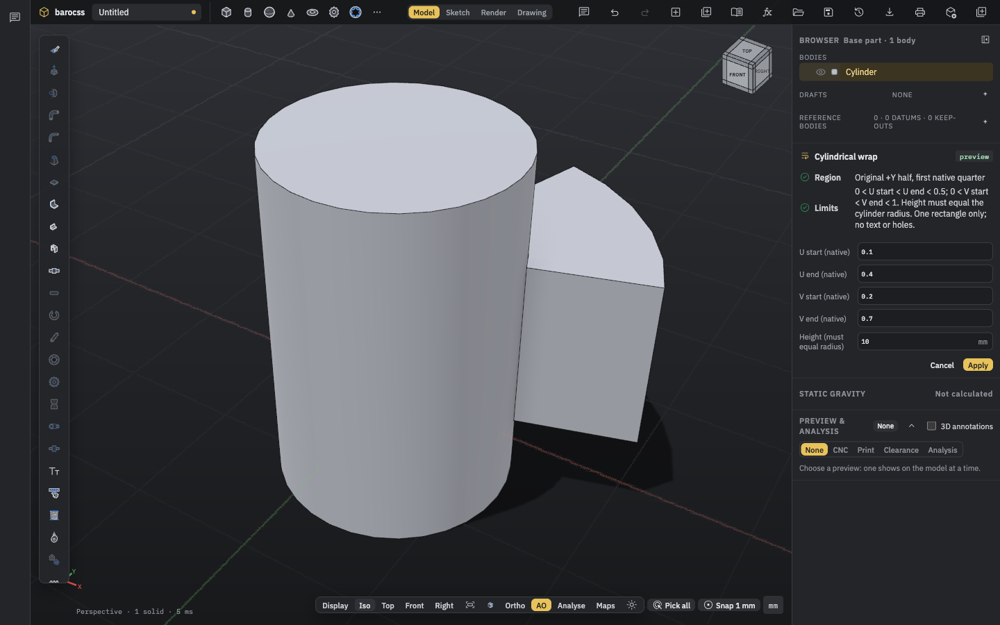
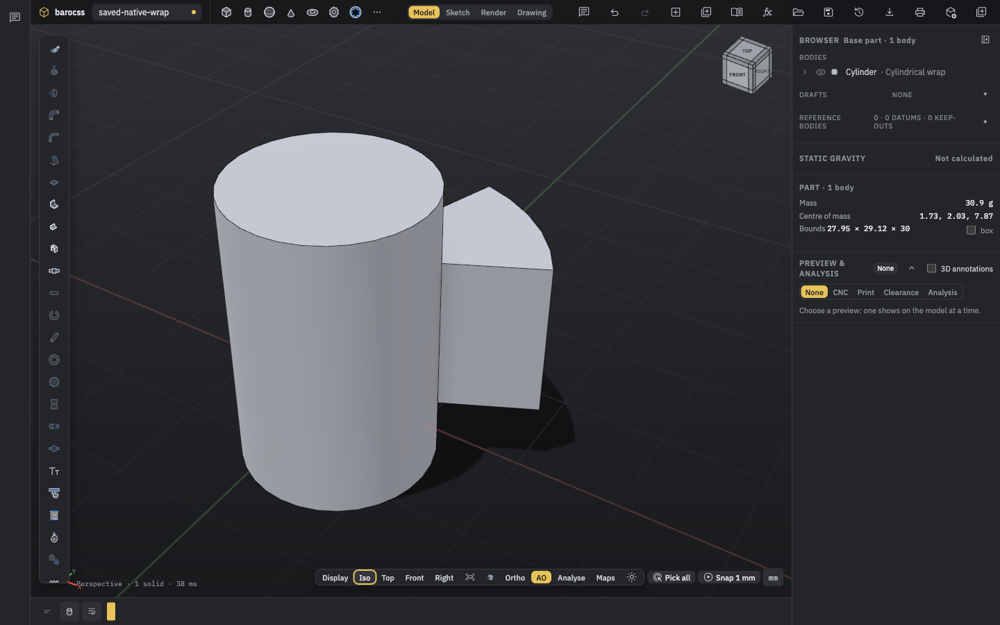

# D313 — Bounded cylindrical wrap in Part, Model, API and Studio

Date: 2026-10-29. Runtime/source commit: `f29df9217cf913cc1493f122a808075e5218d411`. The local bounded Part/Model/API/Studio implementation has whole kernel, Model and Studio regression evidence, plus actual scripted and interactive Chrome/WebGPU evidence. The whole kernel suite has 2193 total / 2187 passed / 0 failed / 6 existing skips; Model has 1833/1833 passed; Studio has 365/365 passed. Generated agent-tools/refusals checks, the reviewed API inventory's six-rule SCOPED_PASS and final docs checks also pass. These results qualify the stated local source and bounded feature; they do not establish general wrap support or release status. The parent owns the D313 decision and roadmap update. No push, PR, deployment or release is claimed.

The implementation started from `3c62968bd2f4c292964181231e9e48ca9564d737`. Tests and actual browser receipts used the frozen runtime changes now recorded in `f29df9217cf913cc1493f122a808075e5218d411`. This note and its evidence are separate handover files; they are not claimed to be part of that runtime commit. No extra test run is claimed merely because the source was committed.

## Product contract

`cylindrical-wrap` is one rectangular outward pad on an original origin-centered, upright native circle extrusion. It uses the original +Y half-wall's first native quarter. The input must satisfy `0 < u0 < u1 < 0.5` and `0 < v0 < v1 < 1`. The positive outward height must equal the actual source radius; the outer XY factor is exactly two. The kernel also proves the native boundary margins under its existing limits.

There are no text, holes, arbitrary outlines, general depth, engraving, seam-crossing or tilted-cylinder options. A subsequent consuming feature refuses with a typed error. This bounded implementation does not complete general glyph wrapping or later roadmap work.

The Part feature stores `target`, one exact native face in `faces`, `rectangle: { u, v }`, `height` and optional expected face geometry. The Model recipe uses a `parent` body reference and stores its individual face signature. The facade method is `cylindricalWrap(faceSelector, { u0, u1, v0, v1, height })`. Studio and the agent use the same command values.

The normal display still merges the two native half-walls into `n1.side0`. The command and Model facade explicitly use the selected cylinder's original +Y half. They identify the member from its geometry and store its exact native name; the fixture name is `n1.side0#2`. Production code does not infer a suffix or silently select the opposite half. Individual signatures use canonical tessellation quality 8, independent of display quality. Native member candidates are enabled only for wrap references. Ordinary reference matching retains its prior merged-face candidates. Moved and exploded display bodies omit this source-coordinate metadata.

Create and edit HUDs show the fixed Region and Limits rows before Apply. History opens the command editor. Preview, refusal without mutation, Apply, Undo/Redo, history edit, Cancel, Save, fresh Open and re-edit have actual browser evidence below.

## Geometry and mass authority

The output reports `authority: 'closed-original-radial-reference'`, `closedReferenceCertified: true` and `nativeFaceAssociationCertified: true`. Native face association retains the actual `1e-7` tolerance. The following remain false: `literalStoredBrepClosureCertified`, `literalStoredBrepMass` and `nativeSIAccuracy`. A closed reference is not a proof that all rounded stored coefficients meet in exact arithmetic.

The live evaluated provider returns MMGS mass properties of that closed reference. A copied or serialized output/report cannot supply that provider. Saving and re-evaluating the recipe builds a new provider. Public native-SI inertia reads refuse with `NATIVE_SI_PROVENANCE_UNAVAILABLE`, reason `combined`; the Model/wire adapters preserve the refusal. The public wrapper does not change the private proof's MMGS values. Default Model density 2.7 is checked against the native provider; the UI's arbitrary material-density rescaling is not a new independent accuracy audit.

## Browser-specific cap correction

The first actual Chrome run exposed a valid source that the Node-only path did not cover. For R10, Chrome's original lower-arc poles produce cap rectangle minima `-10.000000000000002` and maxima `10`. The earlier closure proof required the ideal `[-R, R]` rectangle bit for bit. It refused before preview with `original coefficient bits differ from the required reference binding`.

The fix reads and proves the complete actual affine cap: its two-by-two poles, unit weights, clamped degree-one knots, outward orientation, positive finite spans, actual center and both cap frames. It preserves the original coefficients. The whole-disk correspondence includes the center offset: the L1 bound is the maximum of center displacement and the fresh boundary residual. The exact source identity, native tolerance and scalar/work limits remain in force. No coefficient is snapped to ±R and no tolerance is widened.

## Evidence

- [Validation and proof limits](validation.md)
- [Failures, causes and fixes](failures.md)
- [Interactive browser receipt](evidence/d313-wrap-live/validation.json)
- [Fifth scripted flow](evidence/d313-wrap-flow-fifth.txt)
- [Retained artifact SHA-256 values](evidence/sha256.json)

The saved asset-free `.bcad` file is current-schema JSON, as the existing writer specifies. This is semantic document equality, not a claim of raw-byte identity across Save/Open. It needs no new schema, migration or forced `BCADPACK` container.

The previous long roadmap07 row is retained in `evidence/d313-roadmap-previous-row07.txt`.
The current row summarizes D313 and its remaining ranges; historical intermediate gates stay
in the existing decisions and linked notes. This edit changes no earlier result.
