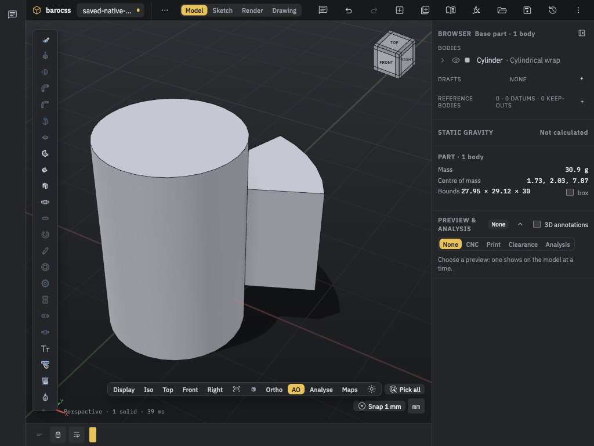

# D313 validation receipt

These local receipts qualify runtime/source commit `f29df9217cf913cc1493f122a808075e5218d411` as described in [README.md](README.md). The whole kernel, Model and Studio suites pass with the explicit kernel skips below. A focused check, a six-rule inventory result and a selected browser flow retain their own scope. No new performance benchmark or hardware-independent latency result is claimed.

## Source and focused checks

| Check | Result | Retained evidence |
|---|---|---|
| Public feature/native SI focused suite after SI wrapper fix | 45/45 PASS | `evidence/d313-kernel-si-focused.log` |
| Affine-cap/closure/feature focused suite | 66/66 PASS | `evidence/d313-affine-cap-focused-final.log` |
| Model affected references/rematch/mesh/command/API/agent/tool/wire checks | 111/111 PASS | `evidence/cylindrical-wrap-model-regression.log` |
| Final Model wrap/placement/assembly/native-wire checks | 18/18 PASS | `evidence/cylindrical-wrap-model-placement-regression.log` |
| Wrap checks after visible create/edit HUD steps | 9/9 PASS | `evidence/cylindrical-wrap-hud-model-focused.log` |
| Studio chat, o17-chat and MCP tool contracts | 27/27 PASS | `evidence/cylindrical-wrap-hud-studio-chat.log` |
| Model type check including tests | PASS | `evidence/cylindrical-wrap-hud-model-tsc.log` |
| Studio type check after final runtime history-route fix | PASS | `evidence/cylindrical-wrap-history-studio-tsc-final.log` |
| Final App lint | PASS, no diagnostics | `evidence/cylindrical-wrap-history-app-lint.log` |
| Changed Model/Studio file lint before the two small HUD/history fixes | Exit 0; 0 errors, 77 warnings in existing browser/chat lines | `evidence/cylindrical-wrap-model-studio-lint.log` |
| HUD command and test lint | PASS, no diagnostics | `evidence/cylindrical-wrap-hud-lint.log` |
| Browser script syntax and diff whitespace after JSON assertion correction | PASS | Tool receipt; no additional runtime changes |
| Whole kernel build | PASS | `evidence/d313-full-kernel-build.log` |
| Whole kernel tests | 2193 total / 2187 PASS / 0 FAIL / 6 existing skips; 308293.825625 ms | `evidence/d313-full-kernel-test.log` |
| Generated agent-tools drift check | PASS | `evidence/d313-agent-tools-first.log` |
| Generated refusals drift check | PASS | `evidence/d313-refusals-first.log` |
| Whole Model tests | 1833 total / 1833 PASS / 0 FAIL / 0 SKIP; 236112.783583 ms | `evidence/d313-full-model-test.log` |
| Whole Studio tests | 365 total / 365 PASS / 0 FAIL / 0 SKIP; 24258.692542 ms | `evidence/d313-full-studio-test.log` |
| Reviewed API inventory | SCOPED_PASS, six rules only | Reviewed refresh; final docs invokes the inventory drift check |
| Final docs checks | PASS; 68 pages, 54 shots, 4668 KiB shots, 858 labels | `evidence/d313-docs-final.log` |

The nine wrap checks cover facade/hand-document/HUD equality; native conversion and default-density core mass equality; stored references; current-schema JSON and package-reader round trips; history edit; invalid UV/height/reference refusal; agent atomicity; worker mesh and mesh-token authority transfer; native-SI refusal; canonical quality-8/16 member signatures; bound height preservation; and removal of source-space metadata from placed/exploded bodies. Counts overlap the earlier affected suites and must not be added as unique coverage.

The kernel display test checks the actual nine-face tessellation: the outer trim, source-wall hole, radial sides and outward triangle orientation. This is separate from visual screenshot inspection and from the closed-reference proof. It does not turn the false literal-coefficient flags into true ones.

## API inventory review and public docs

The first [inventory drift check](evidence/d313-api-inventory-first.json) failed IV001 at `$.coreResultChecks[0].directMembers.length`: expected42, actual43. `CadPartOutput` gains `cylindricalWrap`. The expected inventory was refreshed only after review of the generated candidate. The 16 MB candidate and expected files are not duplicated in this evidence folder.

The [review summary](evidence/d313-api-inventory-review-summary.json) records 6737→6751 rows, 14 added, 0 removed and 154 changed existing rows. Package export maps are unchanged. The [normalized review](evidence/d313-api-inventory-normalized-review.json) identifies 136 changes as literal-union/member-order only. It leaves 18 rows for review; two more (`MassFields` and `VerifierView`) differ only in object-property order. The remaining 16 rows carry the intended wrap contract changes. The [semantic review](evidence/d313-api-inventory-semantic-review.txt) records those member/signature comparisons. The [candidate status](evidence/d313-api-inventory-candidate-status.json) is the earlier generated-for-review record, not a final approval flag.

The final docs check invokes agent-tools, refusals and API-inventory drift checks and passes. Inventory SCOPED_PASS covers only EX001/EX002/EX003/DA001/IV001/IV002. It does not prove every nested JSON boundary, helper error path, immutability, numeric units, runtime behavior or all conventions. Runtime/source and browser checks above are separate evidence. The parent copied the actual small-edit screenshot into the public feature documentation; the final docs result counts 54 shots.

## Original proof limits

The public scalar budgets remain volume `1e-8`, mass `1e-10`, each centroid component `1e-10`, and each independent inertia entry `1e-7`, in the documented MMGS units. Aggregate exact-operation limit is 200000, work limit 1048576 and integer-bit limit 8192. Native tolerance remains `1e-7`.

The retained [cost record](evidence/d313-affine-cap-costs.json) contains these six complete reference requests after the cap correction:

| Request | Exact operations | Work |
|---|---:|---:|
| Standard | 138001 | 295165 |
| Centered | 137005 | 292809 |
| Lower axial pad | 137595 | 294276 |
| Upper axial pad | 137599 | 294276 |
| Asymmetric | 150593 | 320573 |
| Mirrored asymmetric | 150607 | 320411 |

These are bounded mathematical ledger counts, not CPU instruction counts or Studio timing. They qualify those requests, not every rectangle that satisfies the broad UV inequalities. Unsupported geometry or exhausted budgets still refuse.

## Actual scripted Chrome/WebGPU flow

[Fifth run](evidence/d313-wrap-flow-fifth.txt): starter step and selected wrap step **PASS**. This is two selected steps, not all 36 numbered steps and not the full browser suite. Renderer is WebGPU, DPR 1; canvas CSS/backing dimensions are 1140×900.

The test creates R10/H30 at source Z0 through the real palette/HUD. It selects the normal merged wall, sees the Region/Limits rows, previews U[.1,.4]/V[.2,.7] with height10, refuses height9 without changing the accepted base, applies, undoes/redoes, edits U start to .15, saves, opens the saved file in a fresh document and opens its editor again.

At each applicable accepted state it waits for a fresh result, deferred `massReady`, exactly one finite body and the expected volume within `1e-7`; it checks the one-body outliner and absence of `.vp-error`. Expected volume comes from an independent native-quarter endpoint-ray `atan2` annular-sector formula, not returned mesh data. The `.bcad` download is decoded as strict UTF-8 JSON and compared with the entire accepted document, including format, current schema, nodes, outputs and parameters. The writer and schema are unchanged.

## Actual interactive browser flow

The [interactive receipt](evidence/d313-wrap-live/validation.json) records normal canvas selection, preview, Apply/Undo/Redo, fresh Open, re-edit after Open, invalid height, collapsed UV interval and Cancel restoration. The source saved in [the real file](evidence/d313-wrap-live/saved-native-wrap.bcad) is R10/H30, source Z[-7,23], exact bound face `n1.side0#2`, U[.15,.4], V[.2,.7], height10, schema3. Saved document semantic equality is true.

The saved fixture has V end .7. After fresh Open, the actual editor changed V end to .75 and applied it. That final state has U[.15,.4]/V[.2,.75]. Recorded final volume and independent expected volume are both `11443.322154307714`. The manual view selection was Front. The record has no page errors. Viewport sizes checked are 1440×900 and 1024×768. Small edit HUD bounds are x745/y206.5/width279/height354.5, within that recorded viewport. The `small-edit.png` snapshot catches an `evaluating…` transition; it must not be labelled a settled preview. The final small screenshot shows the applied one-body result.

An earlier interactive driver timed out on an incorrect history selector. A fresh browser context reopened the real saved file and repeated Save/Open and edit checks; the receipt records that recovery. Do not describe the entire driver session as uninterrupted.

## Boundaries that remain open

- General text/glyph wrapping, arbitrary outlines/depths, engraving, seams, holes, tilted cylinders and general surfaces are not implemented here.
- Further consuming features are refused in focused tests; actual unsupported-modifier UI flow is **NOT_RUN**. Original unplaced source metadata does not authorize placed/exploded wrap authoring.
- Literal stored B-rep exact closure/mass and native-SI accuracy remain unclaimed. Native-SI provenance reads refuse with reason `combined` even after wire transfer and recipe re-evaluation.
- The live provider is owned by evaluated outputs; an output copy or serialized report supplies no mass authority.
- Arbitrary material-density UI rescaling has no new independent audit in this receipt.
- This local Chrome/WebGPU evidence does not cover other browsers, WebGL2 fallback, other DPRs or the whole browser suite.
- No new benchmark, push, PR, deployment, publication or release is established.
