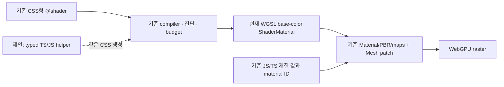

# GPU 엔진과 재질·셰이더 작성 리뷰

**CSS형 셰이더 작성 기반은 이미 있다. 공개 API에서 실제 GPU 화면까지 연결된 것도 확인했다.** 다음 개선의 중심은 기존 재질·씬·셰이더 작성 경로를 연결하고, 같은 compiler를 사용하는 코드 작성 API를 제공하는 것이다. Three.js급 전체 표현력에는 programmable material slot, vertex, render pass, backend와 resource 계약의 추가 작업이 필요하다. 작은 wrapper만으로 그 전체 범위를 완료할 수는 없다.

권고는 **기존 CSS형 `@shader` + 선택적 typed TS/JS 작성 helper + 기존 Material/Scene material-ID 모델의 재사용**이다. 기존 parser/compiler와 별개의 shader 언어·optimizer·renderer를 먼저 만들지 않는다. 제품 코드는 변경하지 않았다.

## 기준과 증거 구분

- 소스 기준: `d85558ce0031d812341d5871743f8535520eb8d4`. 32개 committed source의 hash/Git blob, 18개 근거 주장과 17개 관련 test 등록 inventory를 기록했다. 파일·주장·등록 개수는 테스트 통과 개수가 아니다.
- 실제 실행: 같은 immutable d855, Node22.19.0, Chrome156.0.8078.48/Apple metal-3에서 공개 CSS material 경로 **한 fixture, 23 assertions PASS**.
- 실행 중 현재 HEAD는 `f841c0c34a1897a88fd75a14d5fe53521181f858`로 이동했다. compiler/material/surface 핵심 파일은 같지만 viewer/camera/pick 변경이 있다. 이를 포함한 현재 제품 전체 실행으로 승격하지 않는다.
- [소스 검토](source-review.md), [소스·test inventory](source-evidence.json), [소스 보충·정정](source-supplement.md), [설계 비교](authoring-options.md), [실제 실행](runtime-followup.md).

**정정:** 1차 소스 검토의 animation 행에서 clip API가 없다는 표현은 너무 넓었다. CPU caller-time TRS clip sampler가 이미 public이다. 아래 표와 source-supplement가 해당 행을 정정한다. 원래 증거는 보존했다.

검토 종료 시에는 HEAD가 `1266cdf24943acc5963bf5e346339e32c9f3da41`였다. 새 Studio Open 수정과 후속 App 분리 WIP는 보존했다. 이번 실행 결과는 계속 d855 고정본에 한정된다.

## 현재 엔진의 기능과 경계

| 영역 | 현재 확인된 기능 | 경계·필요한 작업 |
|---|---|---|
| Scene·Camera·Geometry | immutable Scene/material-ID, Mesh/Geometry/instances, primitive builders, perspective/orthographic·orbit·pan·zoom·fit·ray | 일반 live hierarchical scene graph 전체와 같다고 인수하지 않았다. 새 규모·성능 검증은 이번 범위 밖이다. |
| PBR 재질 | metallic/roughness, normal·roughness·metallic maps, finish, anisotropic highlight 일부, clearcoat, thin-film tint | 완전한 BSDF graph는 아니다. normal/roughness 등 사용자 shader output slot은 확인되지 않았다. |
| 유리·투명 | opacity, double-sided, sorted/OIT, pathtrace의 straight-through alpha coverage | Material에 physical transmission/IOR/thickness/dispersion 입력이 없다. 반투명 표시와 물리 굴절 유리는 구분해야 한다. |
| CSS형 shader | `materialShader`, `@uniform`, `@fragment`, `@let`, bounded `@fn`, 여러 math 함수와 일부 UV profile | 현재 사용자 출력은 base color다. 일반 loop·branch·벡터 graph·자동 clock이 아니다. |
| raw shader | public Material.shader에 WGSL 선언/색 표현식을 연결 | fragment 전체·vertex 전체를 교체하는 API가 아니다. GPU compilation 실패까지 atomic last-good swap을 보장하지 않는다. |
| 텍스처 | RGBA8 입력, UV, mipmap, wrapping/filtering, PBR maps, equirectangular IBL | HDR/cube/compressed texture의 일반 public source는 이 검토에서 확인하지 못했다. sampler DSL compiler가 곧 Viewer의 임의 sampler API는 아니다. |
| 조명·그림자 | hemisphere/IBL, directional/point/spot, PCF/PCSS/contact 등 | raster별 개수·shadow cap이 있다. physical area light는 public 모델에서 확인하지 못했다. pathtrace의 별도 light 계약과 합산하지 않는다. |
| 후처리 | SSAO/contact, grading/tone mapping/vignette, bloom, DoF, outline, MSAA/OIT | 내장 설정은 있다. 임의 사용자 pass·render-target graph는 확인되지 않았다. |
| compute | `computeExperimental.runCompute`의 raw WGSL dispatch/readback | experimental이며 typed node/compute-to-render resource graph와 다르다. |
| animation | CPU caller-time TRS clip sampler, host의 transform/material/uniform 갱신 | sampler에는 clock·renderer·playback loop가 없다. live mixer/skinning/morph는 지정 exports/docs 범위에서 확인하지 못했다. |
| 3D asset IO | 준비된 GeometryInput/PreviewPacket 입력, 이미지 capture | GPU root/viewer/api에서 glTF/GLB/OBJ/STL loader/exporter는 확인하지 못했다. CAD/interop/Studio IO를 GPU Core 지원으로 합산하지 않는다. |
| backend | GPU 패키지의 live Viewer는 WebGPU. GLSL lowering과 별도 Studio WebGL2 renderer가 존재 | GLSL 생성은 GPU 패키지의 자동 WebGL2 fallback을 뜻하지 않는다. Pathtrace는 custom shader를 명시적으로 거부한다. |

위 대부분은 소스에서 확인한 지원 범위다. 실제 실행 증거는 아래의 작은 CSS→material→uniform→capture 경로에 한정된다. 전체 기능표의 runtime PASS가 아니다.

## 이미 가능한 CSS형 작성 방법

아래는 현재 공개 문법이다. 기존 triangle mesh와 viewer가 있다고 가정한다. `mesh.material` setter는 기존 값과 patch를 병합한다.

```ts
import { materialShader } from '@barocss/gpu';

const result = materialShader(`
@shader #wave {
  @uniform time: float(0,2,0);
  @fragment {
    color: mix(#204080,#E08020,sin(time*1.5707963267948966)*0.5+0.5);
  }
}`, { time: 0 });

if (result.ok) {
  const params = Float32Array.from(result.shader.params ?? []);
  mesh.material = { color: '#ffffff', shader: { ...result.shader, params } };
  const time = result.uniforms.find(u => u.name === 'time');
  if (time) params[time.index] = 1;
  viewer.requestRender();
} else {
  // diagnostics를 표시하고 현재 재질을 계속 사용한다.
}
```

현재 결과는 linear base-color `vec3`이다. 기존 color/texture와 곱해지고 lit 재질에서는 기존 PBR 조명을 거친다. 이 API 이름을 fragment 전체 교체나 vertex programming으로 해석하면 안 된다.

host가 uniform과 frame을 관리한다. params는 frame마다 다시 읽지만 code는 shader 객체 identity로 cache된다. code를 바꿀 때는 새 shader 객체를 써야 한다. 같은 객체의 code 문자열 변경을 자동 추적하는 hot reload 계약은 확인되지 않았다.

문법의 source/token/node/depth/uniform budget도 있다. 현재 공통 source64KiB, token4096, scalar uniforms16, expanded nodes256, depth16이다. typed helper도 같은 검증을 지나야 한다. 초기 named params의 clamp와 strict binding validator의 refusal은 서로 다른 계약이므로 새 API에서 조용히 바꾸면 안 된다.

## 실제 GPU 확인 결과

공개 `materialShader`로 위 wave를 compile하고, 원래 메시의 재질에 patch했다. 흰 base와 unlit quad, 128×128, 선언 범위 안의 time0/1을 사용했다. 실행 전에 채널 오차≤2, 비배경 pixel>1000, invalid-source control byte 동일을 고정했다.

| 관찰 | 실제 값 |
|---|---|
| time0의 중심 RGBA | `[166,102,95,255]` — 예상값과 동일 |
| time1의 중심 RGBA | `[224,128,32,255]` — 예상값과 동일 |
| 변화량 | `[58,26,-63,0]` |
| 두 화면의 비배경 pixels | 각각6084 |
| 잘못된 DSL | SYNTAX diagnostic. caller가 적용하지 않음 |
| invalid 뒤 accepted 화면 | 65536 bytes 전체 동일, max delta0 |
| source graph | bundle548 inputs = pinned source547 + owned fixture1. 원본 WIP/외부 browser import 없음 |
| 결과와 정리 | 23 assertions PASS, first failure 없음, browser errors0, viewer/device와 소유 page/context/browser/server 정리 |

아래 두 이미지는 실제 GPU canvas capture다. 부모 검토자도 직접 열어 확인했다.

| time0 | time1 |
|---|---|
|  |  |

[수치·hash·소스 차이·정리 receipt](../../runs/gpu-material-public-20261029/verification.json). pipeline 생성 횟수, invalid raw WGSL의 GPU pipeline 교체 실패, 자연 device loss, VRAM/OOM, 다른 backend와 전체 Three.js 동등성은 **NOT_RUN**이다. 숫자 갱신의 pixel 성공을 재컴파일 횟수나 자원 누수 부재로 해석하지 않는다.

## 핵심 공백은 작성 경로의 연결과 표현 범위다

1. **scene CSS로 재질 전체를 묶는 연결:** 현재 scene selector는 형상·색·배치를 다루고, showScene은 고정 roughness0.5를 사용한다. PBR/finish/maps와 저장된 shader를 selector로 묶는 경로는 없다. 기존 Material 타입·Scene material-ID registry를 연결 기준으로 삼으면 된다. 새 공통 재질 모델부터 만들 필요는 없다.
2. **코드에서 식을 조합하는 수단:** TS로 Material 객체 설정은 이미 가능하다. 부족한 것은 TSL처럼 shader 식을 type-safe하게 조합하는 공개 builder다. CSS 문법을 생성한 뒤 같은 materialShader compiler를 호출하는 얇은 helper가 작은 다음 단계다.
3. **programmable slot:** 현재 base color 외 roughness/normal/opacity·vertex·사용자 post-pass를 프로그래밍하는 범위는 별도다. wrapper 이름만 추가해서 해결되지 않는다.
4. **backend 지원표:** WebGPU raster, Studio fallback, pathtrace에서 같은 material source가 되는지 명시해야 한다. 특히 현재 pathtrace는 custom shader를 거부한다.
5. **hot edit의 수락·자원 계약:** source compile 실패는 caller의 미적용으로 last-good를 유지한다. GPU compilation/allocation까지 검증한 뒤 swap하는 계약, 늦은 결과의 적용 소유권, cache 측정과 shared texture/remove/dispose는 후속 게이트다.

Studio 작성 UI도 이미 있다. `PROPS · CSS SCENE`은 scene parser의 색/형상/배치 입력이며 PBR property를 받지 않는다. `MATERIALS · @SHADER`는 shader compile 후 이름으로 저장한다. Appearance는 metallic/roughness/opacity/image texture/finish/clearcoat/film과 저장 shader 선택을 제공한다. 따라서 작성 UI가 없다는 결론은 아니다. Core의 모든 data-map 기능이 Studio에 노출됐다는 뜻도 아니다. 이번 GPU fixture는 Studio source editor의 Save/Open까지 실행하지 않았다.

## 권장 구조



CSS와 helper는 같은 의미·uniform layout·진단·budget을 가져야 한다. 이미 공개된 IR도 source를 다시 compile하고 canonical 데이터와 비교하므로 임의 graph의 통로로 우회하지 않는다. helper의 code 예시는 [설계안](authoring-options.md)에 **미구현 제안**으로 분리했다.

Three TSL은 Node/NodeBuilder, material·geometry·renderer·backend 문맥과 연결되어 있고 WGSL/GLSL code를 생성한다. 따라서 단순 문자열 생성 함수처럼 그대로 꽂으려면 adapter 작업이 필요하다. 현 단계의 선택은 같은 compiler를 쓰는 native helper다. [공식 TSL 문서](https://github.com/mrdoob/three.js/wiki/Three.js-Shading-Language).

Three NodeMaterial은 color/position slot과 vertex/fragment 전체 교체를 구분한다. 이것은 향후 slot 설계의 참고 기준이며 현재 BaroCSS 지원을 뜻하지 않는다. [공식 NodeMaterial 문서](https://threejs.org/docs/pages/NodeMaterial.html). Three WebGPURenderer의 TSL은 WebGL2 fallback도 대상으로 삼고, 기존 ShaderMaterial/RawShaderMaterial/onBeforeCompile 방식은 지원하지 않는다. BaroCSS의 raw WGSL 경로와 자동 호환으로 설명하면 안 된다. [공식 renderer 안내](https://threejs.org/manual/pages/webgpurenderer).

## 로드맵에 연결할 순서와 완료 증거

| 순서 | 최소 작업 | 기존 게이트·완료 조건 |
|---|---|---|
| GMAT-1 | 기존 작성 경로를 문서·sample·지원표로 연결 | G18.2/G18.3. 이번 한 CSS pixel 증거를 기록하고 API/Studio/CPU lowerer/backend를 구분한다. 재질 map 검사들의 기본 test 등록·실행 범위를 보강한다. |
| GMAT-2 | 선택적 typed helper → 기존 CSS compiler | G18.2/G18.3, R7.5b. 같은 wave가 같은 의미·layout·진단·budget을 갖는다. 별도 언어·일반 graph compiler를 복제하지 않는다. |
| GMAT-3 | scene style에서 기존 material-ID·PBR·shader 참조 연결 | R7.5b/기존 Material, Studio consumer. 먼저 작은 PBR 속성과 저장 shader 참조를 연결하고 asset binding·미지원 property·last-good 경계를 검증한다. 전체 CSS cascade를 전제로 하지 않는다. |
| GMAT-4 | sampler DSL의 실제 Viewer bridge | G18.2/material-map 게이트. 기존 compiler의 texture profile을 명시적 binding/UV/resource 계약으로 연결한다. CPU GLSL/WGSL 출력만으로 renderer 지원을 완료 처리하지 않는다. |
| GMAT-5 | live 편집의 안전한 적용과 측정 | G18.3/G15-accept/resource lifetime. source·GPU compile 실패 때 accepted 재질을 보존하고 이전 revision 완료를 배제한다. uniform 변경의 pipeline 생성 횟수와 여러 code 교체의 cache/resource 정책을 실제 측정한다. |
| GMAT-6 | 실제 필요한 material/vertex/post target부터 확장 | G15 및 SDK/Studio 소비 게이트. 한 slot씩 입력/출력·normal/bounds/shadow/picking·원래 CAD 형상과의 의미를 정의한다. 내장 post 설정으로 해결되는 작업은 재사용한다. |
| GMAT-7 | 물리 유리·backend별 shader parity 등 렌더링 확장 | G15-accept/기존 후속. 실제 굴절/IOR/thickness와 alpha를 구분한다. pathtrace custom material은 별도 subset·거부 계약부터. 전체 Three parity를 한 작업으로 묶지 않는다. |

이 순서는 제안이다. 현재 소유자의 정확성 작업 순서나 구현 권한을 바꾸지 않는다. 엔진·API·Studio에 각각 필요한 완료 증거를 붙이며 새로운 병렬 구현 큐를 만들지 않는다.

## 검증 공백과 보존할 계약

- `viewer-material-maps-browser`와 관련 material bindings/maps/pathtrace-map CPU 파일들이 package 기본 test/test:browser 목록에 포함되지 않은 것으로 조사됐다. 파일 존재를 CI 실행으로 부르지 않는다. 범위와 경로는 source-review의 등록 표를 따른다.
- 과거 G18.2 pixel 요약은 있지만 현재와 동등한 완전 source/profile raw receipt는 찾지 못했다. 이를 새 실행으로 합산하지 않았다. 이번 d855 단일 CSS fixture가 해당 작은 공백을 별도로 채웠다.
- scalar params는16개/64bytes다. host clock·frame·값 갱신이 필요하고, 일반 Material 객체 공유가 모든 Mesh의 속성을 동적으로 공유하는 계약은 아니다. shader/texture 참조의 공유와 구분한다.
- Material은 별도의 dispose resource class가 아니다. Geometry/ImageTexture/Viewer/PathTraceSession과 per-mesh buffer의 기존 owner 계약을 유지한다. shader pipeline cache 잔류와 물리 VRAM 반환은 별도 측정이다.
- 실제 primitive/Scene/Camera/asset IO/clip playback/lighting/maps/pathtrace/compute 전체는 이 CSS fixture로 수락하지 않는다. 누락된 기능과 명시된 support profile을 실행 버그로 부르지 않는다.
- GPU003 device-recovery gate와 기존 D323/D324/D325 author receipt 검토는 별도다. 새 shader API나 Three.js 교체, 제품 코드 수정·push·PR·merge·배포는 수행하지 않았다.

## 직접 확인할 파일

아래는 테스트와 같은 고정 snapshot의 파일이다.

- [public materialShader export](/Users/user/Documents/ChatGPT/barocss/.omx/research/cad-commercial-readiness-20261029/runtime/studio-ux-d855/packages/barocss-gpu/src/index.ts:269)
- [CSS adapter](/Users/user/Documents/ChatGPT/barocss/.omx/research/cad-commercial-readiness-20261029/runtime/studio-ux-d855/packages/barocss-gpu/src/material/material-viewer.ts:23)
- [parser와 budget](/Users/user/Documents/ChatGPT/barocss/.omx/research/cad-commercial-readiness-20261029/runtime/studio-ux-d855/packages/barocss-gpu/src/material/mesh-material.ts:75)
- [Material 타입](/Users/user/Documents/ChatGPT/barocss/.omx/research/cad-commercial-readiness-20261029/runtime/studio-ux-d855/packages/barocss-gpu/src/viewer/scene.ts:14)
- [Mesh 재질 patch](/Users/user/Documents/ChatGPT/barocss/.omx/research/cad-commercial-readiness-20261029/runtime/studio-ux-d855/packages/barocss-gpu/src/viewer/scene.ts:334)
- [shader pipeline·uniform 갱신](/Users/user/Documents/ChatGPT/barocss/.omx/research/cad-commercial-readiness-20261029/runtime/studio-ux-d855/packages/barocss-gpu/src/viewer/viewer.ts:877)
- [고정 vertex와 base-color hook](/Users/user/Documents/ChatGPT/barocss/.omx/research/cad-commercial-readiness-20261029/runtime/studio-ux-d855/packages/barocss-gpu/src/viewer/shaders/surface.ts:9)
- [pathtrace 거부 계약](/Users/user/Documents/ChatGPT/barocss/.omx/research/cad-commercial-readiness-20261029/runtime/studio-ux-d855/packages/barocss-gpu/src/viewer/path-trace-scene.ts:22)
