# GPU feature result target gallery

**TARGET DESIGN / NOT ACTUAL ENGINE CAPTURE.** These PNGs are AI-generated visual design references created with the built-in image-generation tool. They are not BaroCSS GPU output, tests, screenshots, numerical or performance evidence. No implementation, editor UI, develop changes, runtime validation, release or merge is included.

Current product naming is cad-studio. Historical issue titles may mention cad-editor or render-editor; those links establish engine feature provenance, not a proposal to restore the old editors.

## Choose a feature
- **Concrete issue/source-backed concepts:** 01 directional light, 02 point range, 03 UV source update, 04 material color, 05 light color, 07 surface UV, 08 depth, 10 FOV, 11 far clipping, 12 shared geometry, 13 translation, 14 parent rotation, 15 positive scale, 16 procedural repeat, 17 optional source repeats, 23 native boundary overlay. These include CPU/source stages; none are actual GPU captures.
- **Future graphics/design proposals:** 06 alpha composition, 09 shadows, 18 PBR roughness, 19 environment lighting, 20 alpha cutout, 21 morph, 22 skeleton skinning, 24 spotlight cone, 25 material sidedness. Broad roadmap names do not freeze APIs or establish implementation.

## Evidence and scope (2026-10-16)
- [GPU Engine Roadmap](https://github.com/barocss/barocss/wiki/GPU-Engine-Roadmap): E3 UV textures; E4 later material/light maturity; postprocessing/backend acceptance separate.
- [#1579](https://github.com/barocss/barocss/issues/1579): authored directional-light qualified Surface WebGPU viewport. Board01 changes intended light direction only. Legacy opaque/diffuse profile; no cast shadows, PBR, reflective environment or actual device claim.
- [#1584](https://github.com/barocss/barocss/issues/1584): bounded point lights. Board02 changes intended range only. Artistic weight max(1-d/r,0)^2, not physical inverse-square. Source/software stage and external physical-device acceptance are separate. No numerical brightness validation.
- [#1184](https://github.com/barocss/barocss/issues/1184): source-adopted generic EngineUV UNLIT texture route; actual generic device/pixel/lifetime acceptance explicitly UNRUN in issue. Board03 changes one source image region, nearest/clamp unchanged.
- [Pinned texture source](https://github.com/barocss/barocss/blob/88c3342e208e721be859089372bd09d12e5173ae/packages/barocss-gpu/src/engine-texture-bindings.ts) admits opaque rgba8/srgb/bottom-left/nearest/clamp-to-edge only. No linear filtering, alpha or generic PBR is represented.
- [#1512](https://github.com/barocss/barocss/issues/1512) and [#674](https://github.com/barocss/barocss/issues/674) retain actual runtime/integration evidence gates.

## Boards
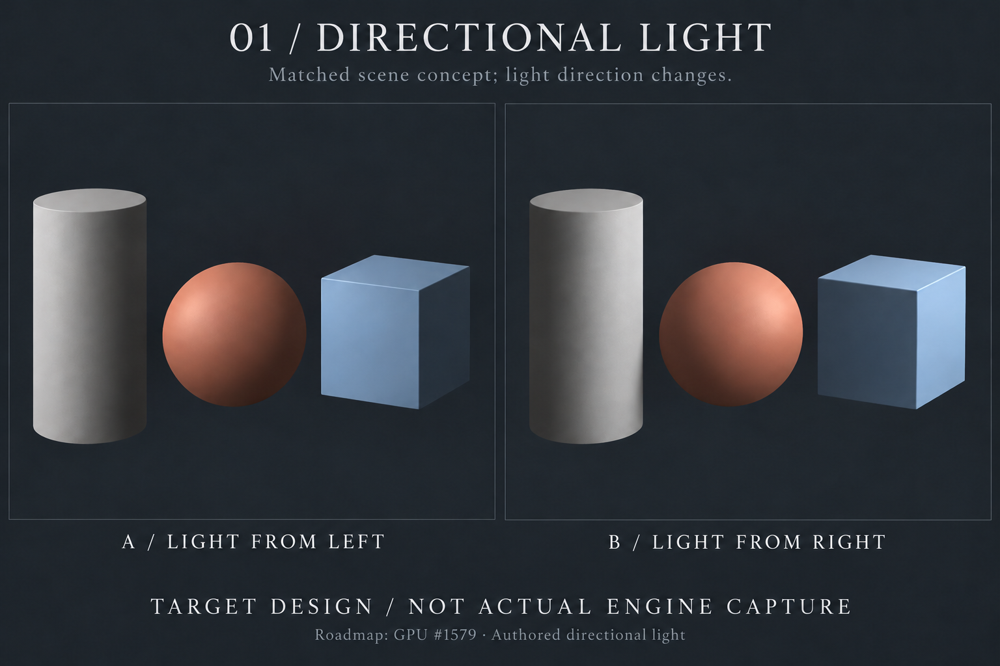
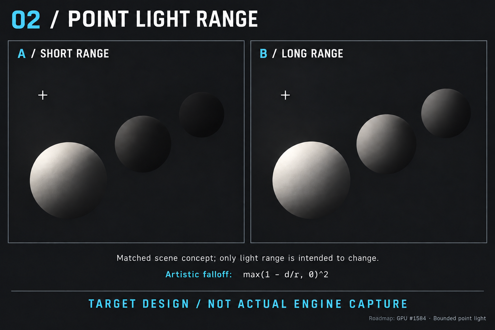
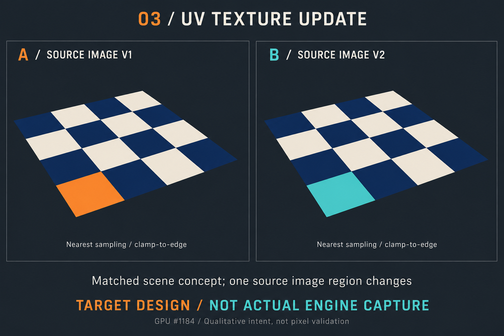

## Design review and evidence limits
Panels use matched scene concepts and intended single-variable changes. Image generation introduces minor silhouette, placement, surface texture and brightness drift. These are qualitative visual targets, not controlled captures, geometry equality, shader-equation or sampler validation. Actual validation must later use real engine output with identical source/camera/geometry and pinned backend. No such run occurred here.

The first directional and point images were independently visually reviewed; embedded strict Same geometry wording was replaced with matched-concept wording. A rejected UV filtering draft was not published: current source admits nearest only. Final UV draft removes ground/cast shadows and replaces the proposed filter comparison with source-image update.

## Initial design queue (now covered below)
1. Covered: authored light color relationships under #1445/#1579 (Board05).
2. Covered: opaque material uniform/color expressions under #779/#1439 (Boards04/07).
3. Covered after reading #1237: separately labeled future transparency target (Board06).
Shadows, environmental reflections, physically based materials and postprocessing are not current-support claims; require their own grounded future-design scope before adding imagery.

## Publication
Only docs/design/gpu-feature-gallery/ on branch design/gpu-feature-gallery-20261016. Base develop snapshot 88c3342e208e721be859089372bd09d12e5173ae was read, never modified. No application/package source changes. Prompts are in prompts.json.

## Additional reviewed targets
- Board04: [opaque material color uniform #779](https://github.com/barocss/barocss/issues/779). Intended base-color change, fixed camera/geometry/light. No PBR or texture support inferred.
- Board05: [authored light color #1445](https://github.com/barocss/barocss/issues/1445) / [directional profile #1579](https://github.com/barocss/barocss/issues/1579). Intended light RGB change on neutral matte materials. Not a colorimetric measurement.
Both images were inspected and independently accepted as qualitative concepts. Existing capture and geometry-drift limitations apply.

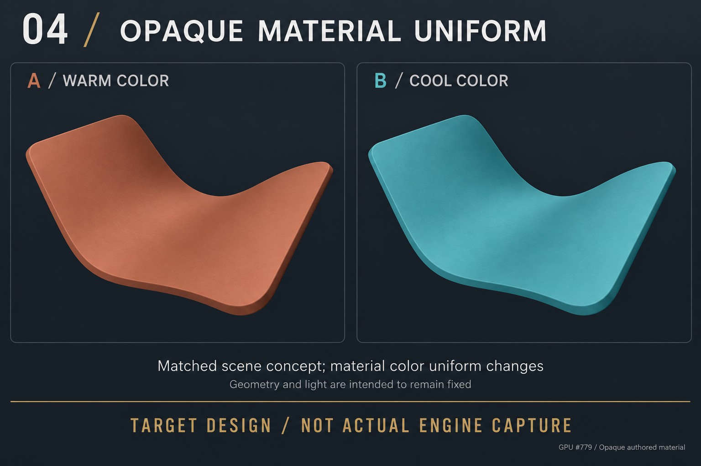
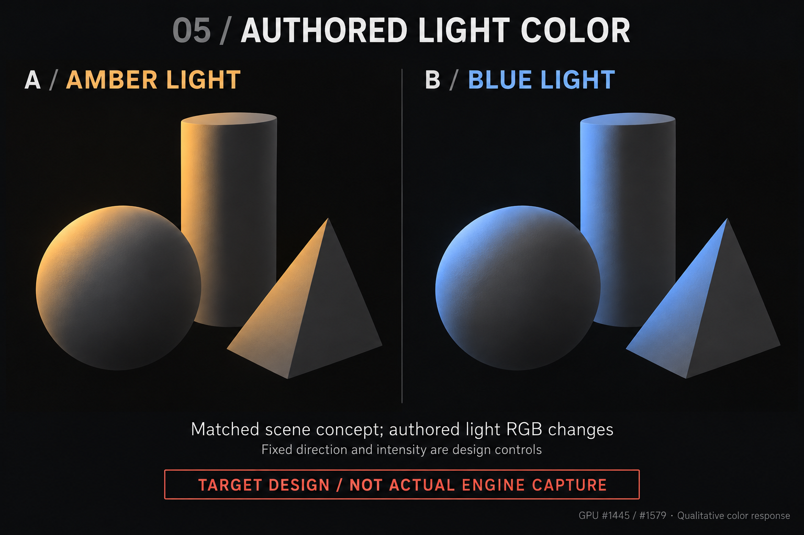

## Future opacity and normalized native coordinates
- Board06 is explicitly a **future graphics target** for [#1237](https://github.com/barocss/barocss/issues/1237). CPU opacity/order preparation does not establish rendered alpha support. It depicts simple source-over intent without refraction, Fresnel, shadows or physical glass. No numeric alpha calibration is claimed. Independent review rejected the initial dark-mask overlap; final brighter warm/neutral overlap and nonnumeric labels were reviewed.
- Board07 maps direct U/V gradients from [#1432](https://github.com/barocss/barocss/issues/1432) and native binding [#1439](https://github.com/barocss/barocss/issues/1439). Normalized derived shader coordinates are not exact native geometry queries. CPU/compiler/binding completion does not establish a real current-runtime capture. Camera/surface shape are intended controls, not identical pixel geometry.
Both final PNGs were inspected and independently accepted as qualitative target designs.

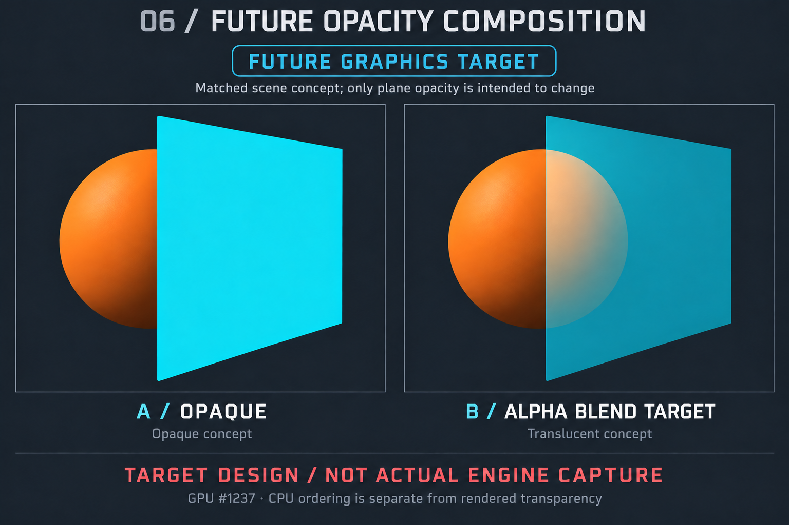
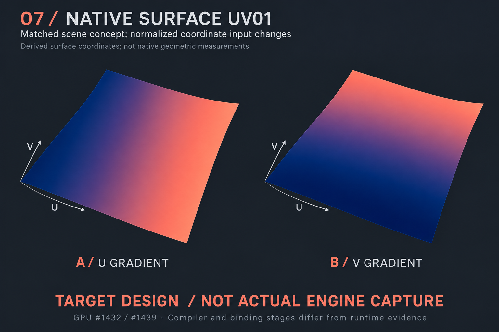

## Shared depth and future cast shadows
- Board08 follows [#1059](https://github.com/barocss/barocss/issues/1059), specifically its front/behind native Surface and original SDF Sphere scenarios. Only surface depth is intended to change; these are opaque occlusion targets, not transparency or draw-order tricks. Related [#1072](https://github.com/barocss/barocss/issues/1072) addresses multiple native Faces on shared depth but is not the mixed-profile authority. No runtime status is inferred.
- Board09 follows the exact [GPU Engine Roadmap E4 — scene service maturity](https://github.com/barocss/barocss/wiki/GPU-Engine-Roadmap#e4--scene-service-maturity). That section places shadows behind original unit/color/light contracts and real pixel evidence. This image is a PLANNED/FUTURE visual target only, NOT implemented support or an API/algorithm commitment. The cast shadow follows the upper-left lighting and attaches at sphere contact. The unshadowed panel has no ground/contact shadow. Shadow softness, bias, filtering, precision, device support and performance are unspecified, untested and unclaimed.
Both final PNGs were visually inspected and independently accepted as target concepts. The initial shadow draft's unwanted left contact shadow was corrected before publication.

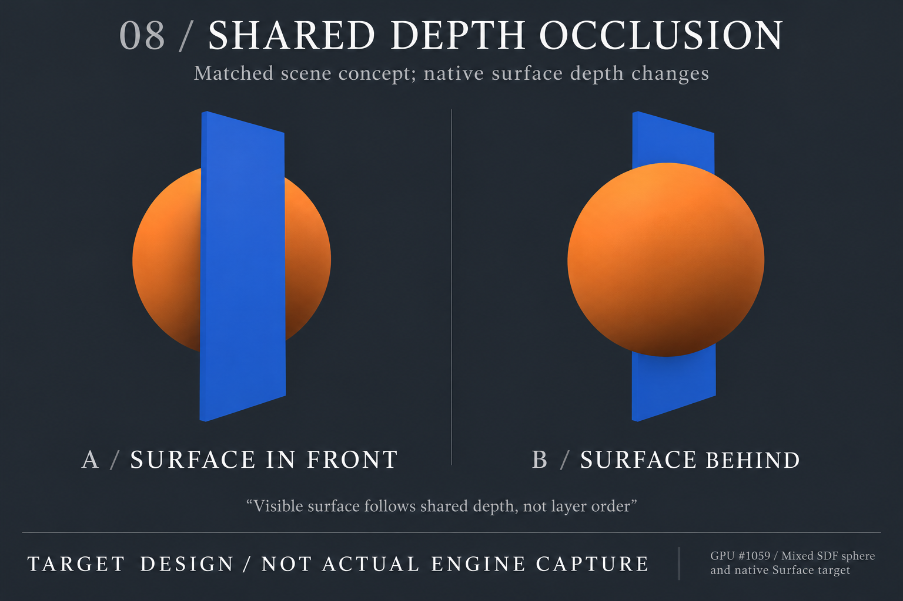
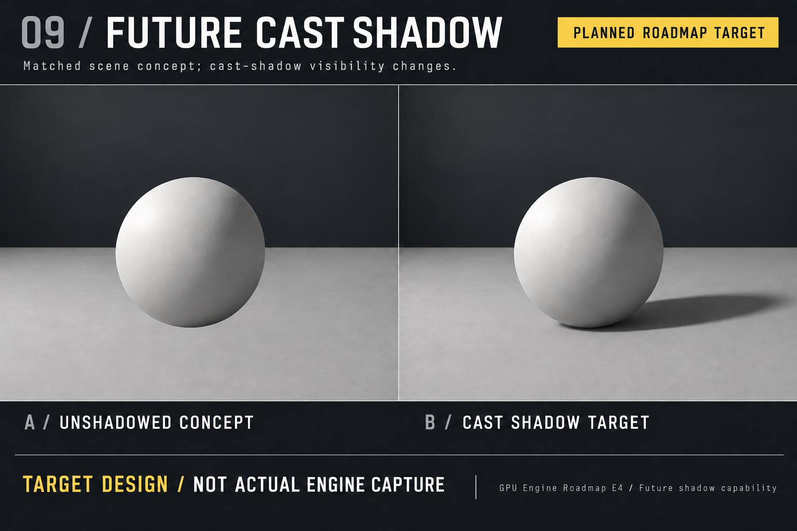

## Camera, shared resources and explicit time
- Boards10/11 use [pinned MeshCamera source](https://github.com/barocss/barocss/blob/88c3342e208e721be859089372bd09d12e5173ae/packages/barocss-gpu/src/camera.ts): perspective fovYDegrees and near/far planes are explicit. Narrow/wide FOV changes projected scale at fixed intended eye/target; far clipping removes a fully distant object without changing near objects. No orthographic API, exact numerical FOV, depth error or real renderer capture is claimed.
- Board12 follows [#1182](https://github.com/barocss/barocss/issues/1182) and [pinned scene source](https://github.com/barocss/barocss/blob/88c3342e208e721be859089372bd09d12e5173ae/packages/barocss-gpu/src/engine-scene.ts): three mesh nodes reference one geometry catalog definition. A new complete scene changes the shared definition while intended node poses remain. This is not an in-place mutable buffer API, GPU instanced draw, measured shared buffer allocation or speed claim.
- Board13 follows [#1221](https://github.com/barocss/barocss/issues/1221): caller-owned explicit time yields a derived translation pose while original geometry/source remains. No automatic playback, clock, physics, motion blur or actual sampled render is claimed. Perspective-facing sides may change as the cube translates at fixed world rotation.
All four final images were inspected and independently reviewed. Incidental generated background shadows were removed from10/11/13 before publication.

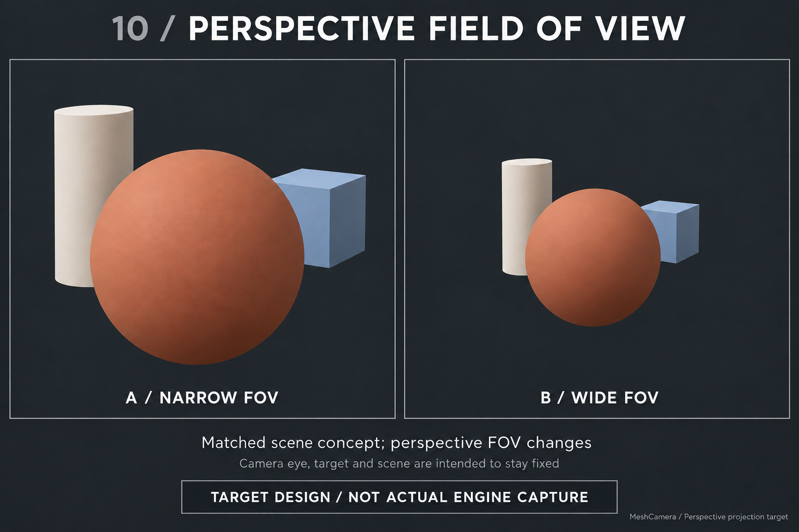
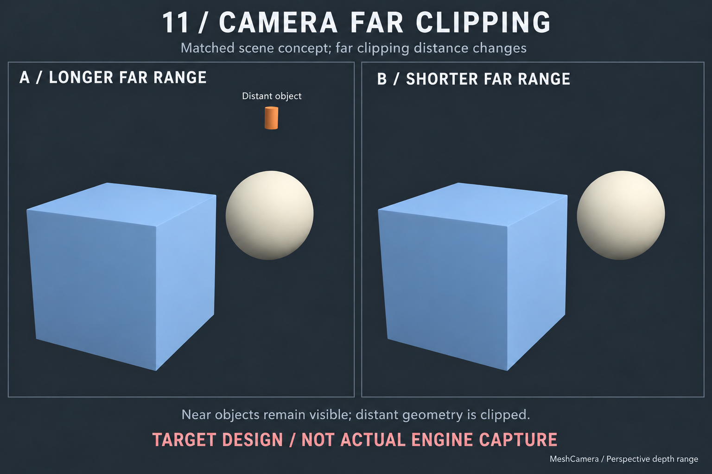
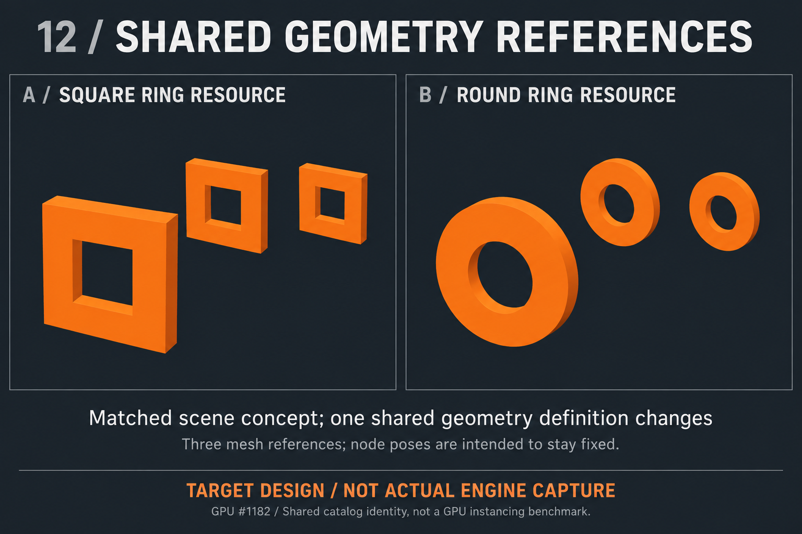
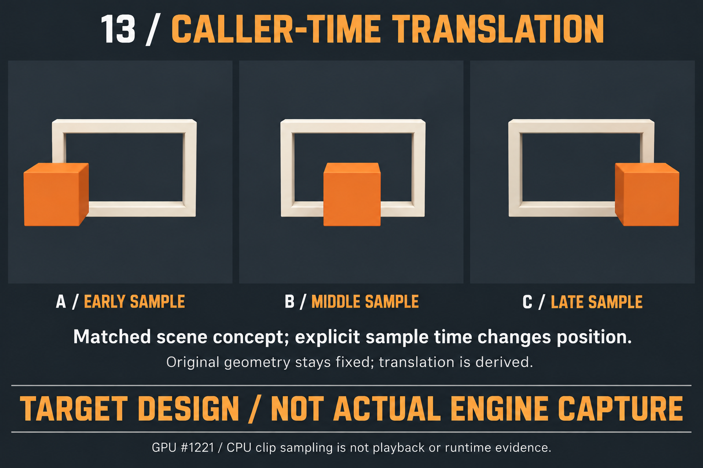

## Parent poses, procedural coordinates and optional repeats
- Board14 follows [#1227](https://github.com/barocss/barocss/issues/1227): caller-time parent quaternion rotation and derived child poses. The source uses shortest-path normalized-linear interpolation, not slerp or constant angular speed. No clock, physics or exact pose sampling evidence is supplied.
- Board15 follows [#1231](https://github.com/barocss/barocss/issues/1231): positive componentwise local scale. The ring widens without a topology edit; no negative-scale/mirror support, exact proportions or native geometry mutation is claimed.
- Board16 follows [#1267](https://github.com/barocss/barocss/issues/1267) / [#1269](https://github.com/barocss/barocss/issues/1269): procedural coordinate fract repeat versus clamp saturation. This is source grammar/binding scope, not texture-sampler wrap support or GPU precision evidence.
- Board17 follows [#1476](https://github.com/barocss/barocss/issues/1476) / [#1494](https://github.com/barocss/barocss/issues/1494): finite source generation with opt-in zero repeats. Two, zero and three repeated spheres appear beside one fixed anchor. Zero preserves the source declaration but produces no repeated objects. This does not establish runtime instancing, GPU instanced draws or measured allocation/performance.
All four final images were inspected and independently accepted as qualitative concepts. Board14's incidental specular hotspot was removed before publication. AI-generated matched scenes are not identical pixel/geometry controls.

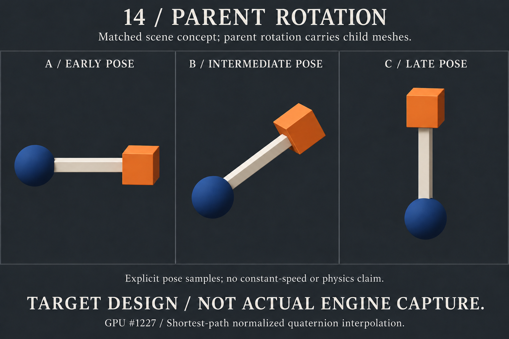
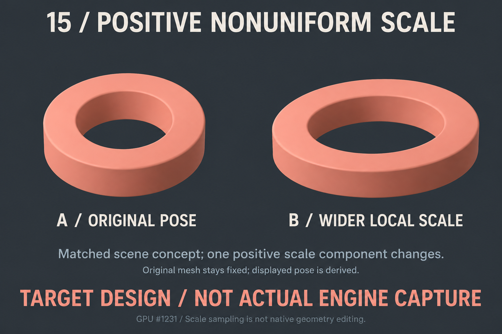
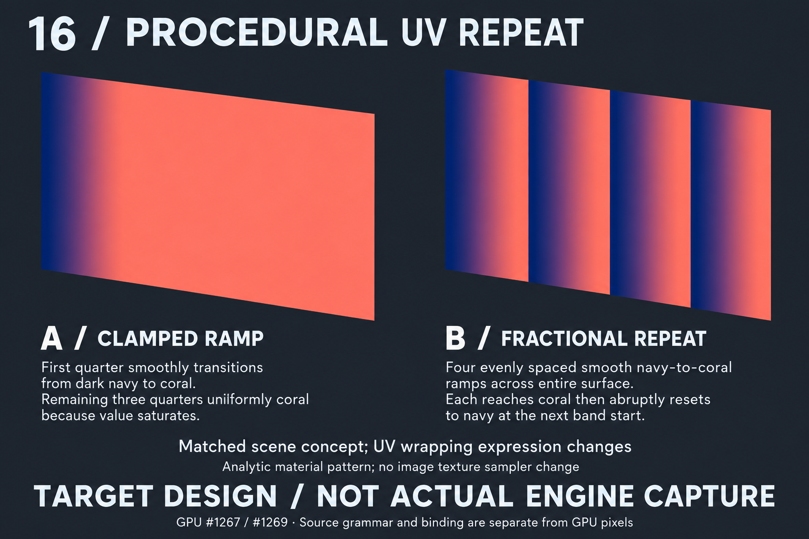
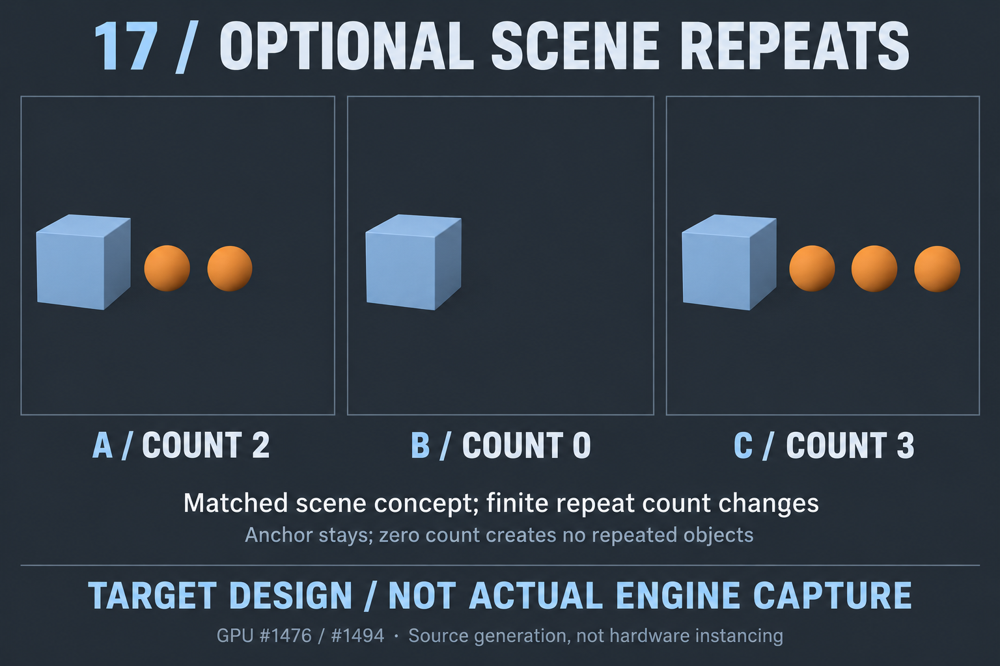

## Future PBR and environment explorations
Boards18/19 are **future design proposals**, grounded only in the [E4 roadmap horizon](https://github.com/barocss/barocss/wiki/GPU-Engine-Roadmap#e4--scene-service-maturity), which requires original unit/color/light contracts and real pixels before shadows/environment/PBR acceptance. They do not assert a frozen BaroCSS API, supported material model, numeric parameter mapping or present rendering capability.
- Board18 explores smoother versus rougher reflection on an intended unchanged neutral metal sphere. Rougher reflections spread and lose sharp environment detail. [Khronos material semantics](https://github.khronos.org/glTF-Tutorials/gltfTutorial/gltfTutorial_011_SimpleMaterial.html) explain roughness as reflected-light scattering; this is a conceptual reference, not adoption of glTF's API or renderer. Visible grain is an illustrative cue, not calibrated microgeometry, roughness or an energy-conservation test.
- Board19 explores a changed environment distribution, broad overhead versus lateral window. Metal reflections and matte diffuse face illumination respond together; material/geometry/camera are intended controls. [Khronos sample environments](https://github.com/KhronosGroup/glTF-Sample-Environments) establish the IBL concept only. No third-party environment assets were used, and no IBL filtering, radiometric accuracy, HDR format, tone-mapping or backend support is claimed.
Both final images were inspected and independently accepted as physically coherent qualitative future concepts. Generative drift and non-runtime evidence limits apply.

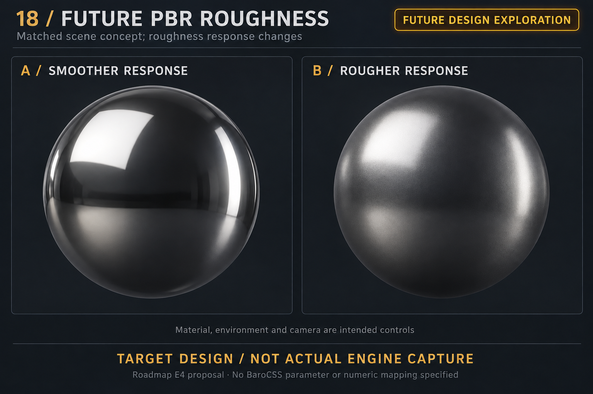
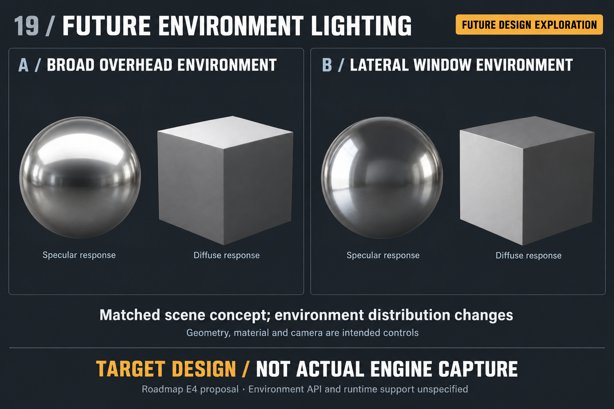

## Future alpha discard and deformation
- Board20 follows the roadmap material/alpha-test horizon and [E4](https://github.com/barocss/barocss/wiki/GPU-Engine-Roadmap#e4--scene-service-maturity). Retained regions stay opaque; discarded regions reveal the untouched scene. This is not tinted blending, CAD hole geometry or an alpha sampler extension to the current opaque texture profile. [Khronos alpha semantics](https://registry.khronos.org/glTF/specs/2.0/glTF-2.0.html#alpha-coverage) are conceptual guidance only; thresholds, edge antialiasing, depth behavior, API and pixel proof remain unspecified. Initial geometric-looking rim cues were removed.
- Board21 follows [E5 skeleton/morph targets](https://github.com/barocss/barocss/wiki/GPU-Engine-Roadmap#e5--assets-and-dynamic-scenes). One continuous one-hole shape develops a local bulge, distinct from rigid transform or topology replacement. [Khronos morph semantics](https://github.khronos.org/glTF-Tutorials/gltfTutorial/gltfTutorial_017_SimpleMorphTarget.html) describe weighted attribute displacement as a concept; no BaroCSS weights, API, vertex correspondence, exact interpolation or volume/thickness preservation is asserted.
- Board22 follows the same E5 skeleton horizon and [Khronos skinning concepts](https://github.khronos.org/glTF-Tutorials/gltfTutorial/gltfTutorial_020_Skins.html). A connected sleeve deforms around a changed joint pose. The yellow guide is explanatory annotation, not an x-ray/editor rendering feature. Skinning algorithm, bone lengths, weights, exact bind matrices, physical volume preservation and runtime are unverified and unclaimed. Incidental generated shadows and wrinkle cues were removed; the bent guide segment was shortened after review to avoid a selective stretching cue. Remaining generative proportion drift is not skeletal length or weight evidence.
These are separately labeled future design explorations, not frozen specifications or current capability. Final images received independent qualitative visual review.

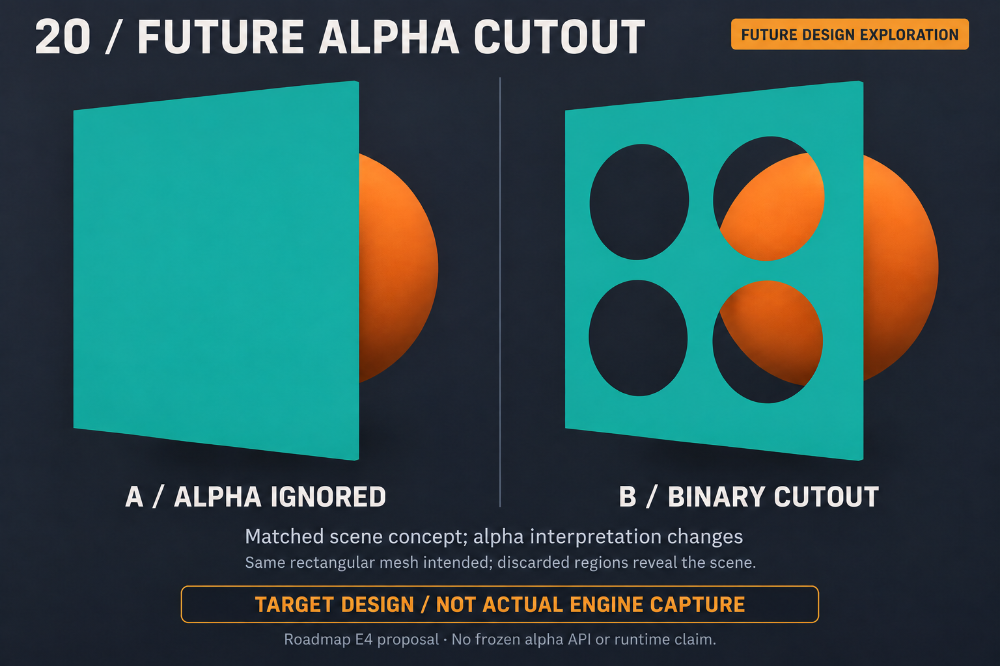
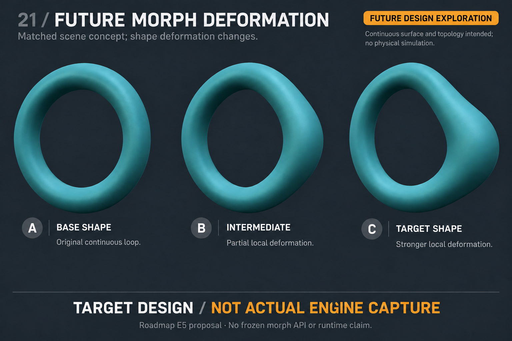
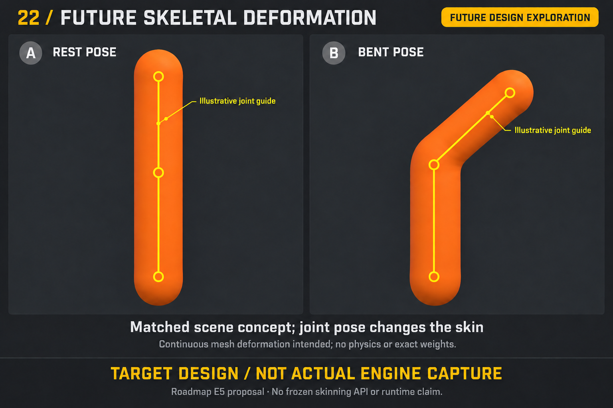

## Native boundary presentation and future spot lighting
- Board23 follows [#1995](https://github.com/barocss/barocss/issues/1995), a distinct native boundary overlay display target. Filled convex geometry remains authoritative; only visible face boundaries are overlaid, with no tessellation diagonals or x-ray hidden lines. CAD design lane confirmed this comparison is not duplicated by its selection/face concepts. This visual is not an exact native edge-count/identity test or proof of depth bias, line width, DPR readability, picking, WebGPU parity or current consumer acceptance. Line darkness/thickness is illustrative; actual source contract uses a bounded shared-depth line path with its own acceptance gates.
- Board24 follows the explicitly named spot-light horizon in [roadmap authored lights](https://github.com/barocss/barocss/wiki/GPU-Engine-Roadmap#actual-light-entity-requirement--1445). A narrower/wider illumination footprint on an unobstructed receiver explores cone spread only. [Khronos spot-light semantics](https://github.com/KhronosGroup/glTF/blob/main/extensions/2.0/Khronos/KHR_lights_punctual/README.md#spot) are conceptual guidance, not BaroCSS API adoption. No angle, inner/outer transition, photometric unit, distance attenuation, energy mapping, bloom, volumetric beam or current spot implementation is claimed. It remains a **future design proposal**.
Both images were inspected and independently visually reviewed. The spotlight draft's extra object and floor were removed to isolate the intended light footprint.

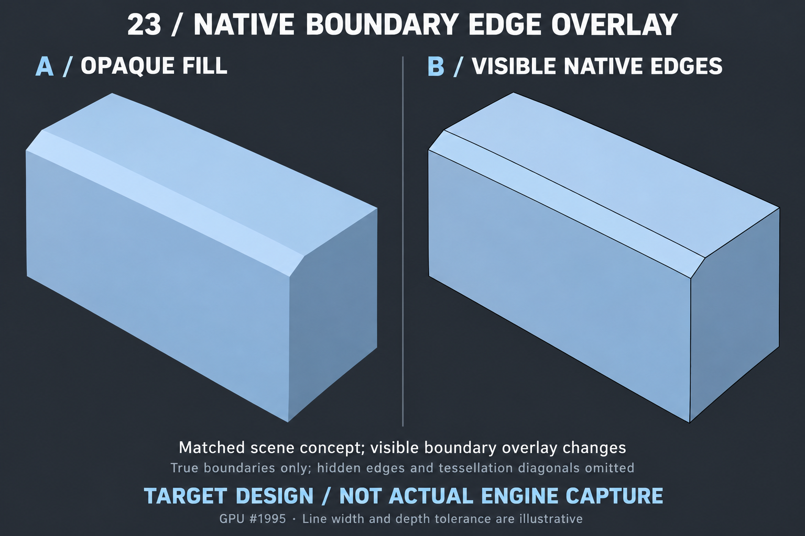
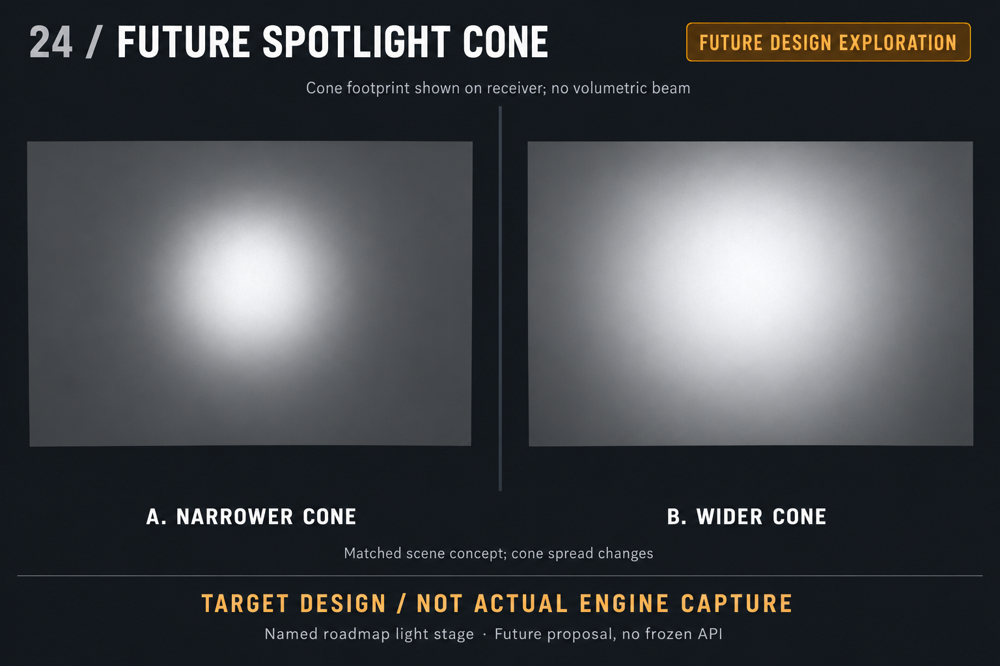

## Future material sidedness
Board25 follows E4's named material side modes. With a back-facing plane held in the same intended view, front-face-only display culls it and two-sided display admits it. The background cube is an occlusion reference. No thickness, transparency, changed camera, normal reversal algorithm, lighting model, exact winding/API or current support is inferred. Flat plane color deliberately avoids a back-face lighting promise. [Khronos sidedness semantics](https://registry.khronos.org/glTF/specs/2.0/glTF-2.0.html#double-sided) are a conceptual reference only, not an imported BaroCSS contract. Independently visually reviewed as a qualitative future proposal.

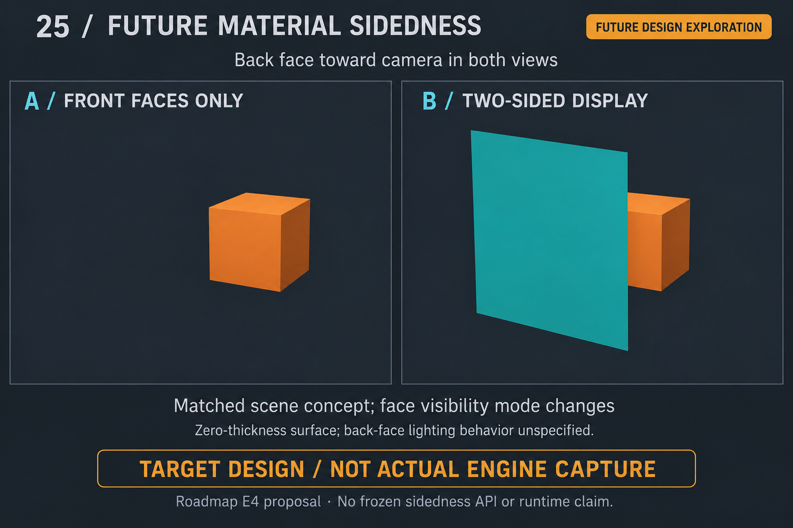

## Coverage checkpoint and remaining evidence
This gallery now covers 25 distinct feature-result concepts with source/roadmap citations, including separately marked future proposals. It does not claim all GPU engineering work is complete.
- Nonvisual contracts still need their actual implementation/evidence: source and resource identity/copies, typed validation/refusal, buffer/texture ownership and budgets, atomic replacement/retention, disposal, device loss/recovery, backend fallback eligibility, import/export provenance and consumer integration.
- Selection/raycast accuracy, barycentrics/UV/normal identity, numeric precision, depth/edge tolerances, color/energy calibration, actual pixels, lifecycle behavior, allocation and performance cannot be established by these generated images.
- Correct frustum culling, resource sharing and hardware instancing need behavioral/resource evidence; additional unchanged-result pictures would not demonstrate the optimization. Existing boards cover visible occlusion, repeated source objects and shared-definition changes without making those claims.
- General LOD/streaming and postprocessing remain named high-level horizons without a frozen visual acceptance target here. No arbitrary simplification thresholds, bloom, depth-of-field, tone-map or effect API has been invented. Exact future contracts may justify new distinct boards later.
- Additional generic color, pose, visibility or alpha-order variants would substantially duplicate current outcomes. CAD selection/geometry and GPU display responsibilities stay separate; native edge overlay was coordinated for nonduplication.
All PNGs are target-design concepts. Only real, separately authorized engine captures and measurements can establish implementation or acceptance.
