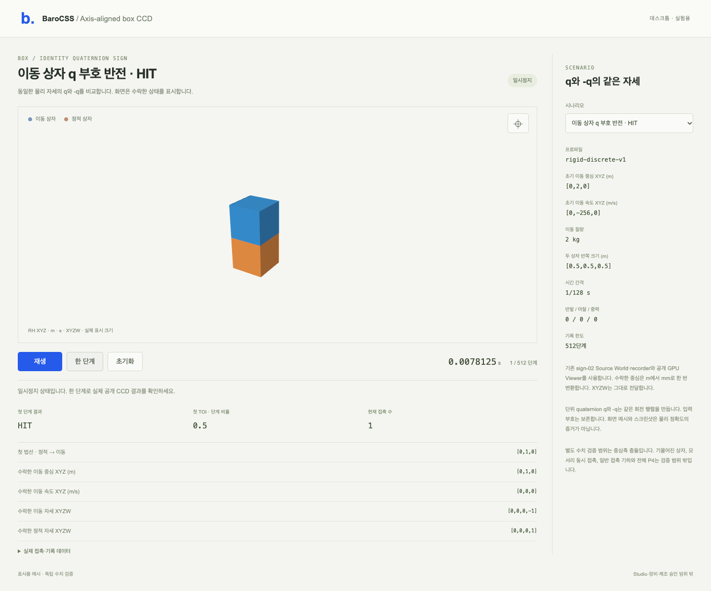

유한 box/static-box CCD 수치 검사와 선택한 desktop rendering이 **PASS**입니다. 전체 G2·P4 또는 일반 contact geometry의 PASS는 아닙니다.

baseline01은 Source/Native 각각20사례, World18개, 승인 step22회, creation refusal4회와 command refusal2회를 완료했습니다. TOI/geometry/normal/spin/tangent/velocity/momentum/energy 잔차가 모두0입니다. 음의 identity quaternion 입력은 당시 INVALID_CONFIG였고 이 admission 경계도 원래 증거로 보존했습니다.

물리적으로 unit q와 -q는 같은 Hamilton 회전입니다. sign02는 axisAlignedBox의 |w-1| 검사를 ||w|-1|로 바꾼 한 줄과 generated provider manifest만 갱신했습니다. threshold와 gate는 바꾸지 않았습니다. build sign02, 독립 BANK-02와 FREEZE-02 후 API02는 Source/Native 각각20사례, World20개, 승인 step24회, creation refusal2회와 command refusal2회를 완료했습니다. 모든 최대 잔차는0입니다. 기존1e-12 TOI/geometry/normal/spin/tangent 및1e-10 velocity/momentum/energy gate와 strict event 분기를 유지합니다. refusal 뒤 state/clock/log 보존과 control 대비 retry도 검사했습니다.

변경 전 provider/source와 baseline은452개 파일의 nested archive로 보존되어 있습니다. 이번 패키징에서 archive와452개 member, 역사적 FREEZE-01의295개 pin을 검증했습니다. current FREEZE-02의294개 pin도 검증했습니다. 원래 bank/freeze와 실패 증거를 덮어쓰지 않았습니다.

원래 thin-box regression01은 CAD types.js import setup 실패로 World0회에서 끝났습니다. driver02/03도 Native World external guard 실패로 World0회에서 끝났습니다. 이 실패들을 유지했습니다. regression04는 실제 Native World를 external로 사용하고 기존 CAD source/data만 bundle해 원래 thin-box 수치 assertion을 통과했습니다. 변환은 import.meta.url의 원래 source URL 복원뿐입니다. CAD Studio의 제품 실행 증거는 아닙니다.

scene build와 실제 desktop render01이 PASS했습니다. Chrome156.0.8078.80에서9개 check와4개 preset,1280/1440/1920 폭을 검사했습니다. page error와 console error는0개입니다. sign02 **Source public World/recorder와 실제 public Viewer GPU**가 수락한 pose/clock을 표시했습니다. mesh pixel, q/-q 동일 회전, 카메라/resize, visible data, step/play/pause/reset 및 record 소유를 확인했습니다. 이는 Native GPU runtime의 실행 증거가 아닙니다. screenshot은 rendering 증거이며 수치 정확도를 대신하지 않습니다.

preview는 이미 생성된 desktop-1440.png를 바이트 그대로 복사한 파일입니다. 재촬영·편집·renderer 재실행은 하지 않았습니다. 기울어진/off-center box, simultaneous edge/corner, general persistent geometry, 장비/제조 및 전체 G2·P4는 검증하지 않았습니다. 원래 cap/tolerance/HOLD와 P4 NO_GO는 유지합니다.

기존 README는 FREEZE-01에 pin되어 있습니다. 갱신 전 바이트를 archive에 보존했습니다. FREEZE-02에는 README entry가 없습니다. 이번 README 결과 갱신은 기존 freeze/pin을 갱신하거나 과거 receipt를 재해석하지 않습니다. historical 재현에는 저장한 원래 README를 사용해야 합니다. 보호된 source/contract/bank/freeze/build/evidence는 변경하지 않았습니다.

전체 own source/build/output, old/current provider와 source bundle, rendering log/screenshot/metafile/model helper, 실패를 포함한13개 box-slab command receipt는 [EVIDENCE-01.tar.gz](./EVIDENCE-01.tar.gz)에 있습니다. member/archive SHA-256은 [EVIDENCE-ARCHIVE.json](./EVIDENCE-ARCHIVE.json), 실제 수치·render 결과는 [RESULTS.json](./RESULTS.json)에 있습니다. 이번 작업은 수치·browser를 실행하지 않았고 stage/commit도 하지 않았습니다. root 소유 preview52980/session59493은 그대로 두었습니다.
