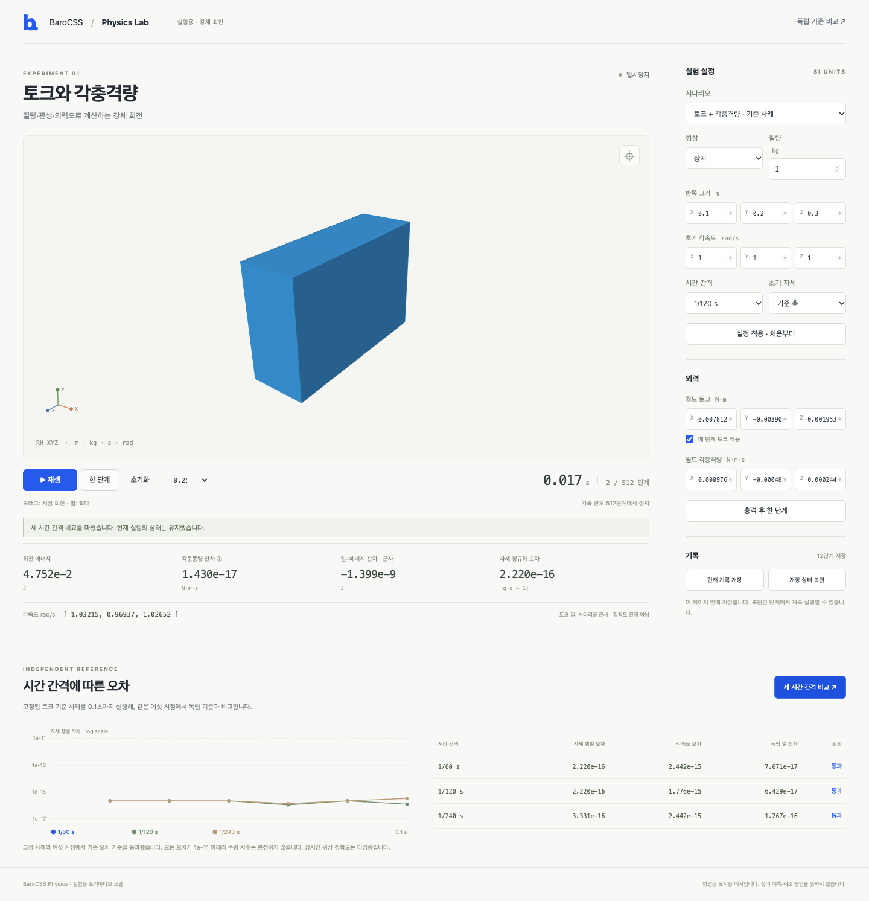

# Physics Lab

A desktop browser sample driven by the current public Physics World/recorder
and Viewer APIs. One blue display proxy follows actual accepted body poses.
No Studio integration or new GPU renderer is used.



This screenshot shows presentation; physical accuracy uses the separate reference checks.

From the repository root, with Node22 and the existing workspace dependencies:

```sh
node examples/physics-lab/server.mjs
```

Open **http://127.0.0.1:52889**. The server binds to localhost only and bundles
this checkout's source APIs. Set `PHYSICS_LAB_PORT=0` for an available port.
Restart the server after edits; it does not hot-reload or alter other tabs.
No dependency/browser download, external service, deployment or release is required.

## Use

1. Select free box rotation, a capsule, an axisymmetric box, or the fixed torque/J case.
2. Set shape, mass, dimensions, initial world angular velocity, initial axis orientation and fixed interval. **Apply** starts a fresh experiment.
3. Play/pause, advance one fixed step, or apply one angular impulse and advance one step. Configured torque is reissued explicitly at each step while enabled; it expires in the World after that step.
4. Save in page memory, continue, restore, then continue again. Save survives a change of model in this page; restore reconstructs the saved model and accepted command log. Reload discards the saved page memory.
5. Drag to orbit; use the wheel to zoom or the camera button to return home. Camera operations do not step Physics.
6. Run the three-grid comparison. It leaves the current experiment unchanged and runs the fixed reference box separately through0.1s at60/120/240Hz.

The recorder's existing512-frame limit remains. Play stops exactly at512;
no automatic history truncation or unrecorded continuation occurs. At120Hz
that is4.2667 simulated seconds. Reset starts a new World and clock.

## Numerical meaning

Inputs are metres, kilograms, seconds, radians, N·m and N·m·s. Angular velocity,
torque and angular impulse use world axes. A capsule's centreline uses local Y.
Display vertices and translation convert m→mm once; accepted XYZW rotations
are copied to public Viewer motion frames. Meshes are display proxies, not
native CAD Surfaces, collision witnesses or measured machines.

The live inspector derives primitive COM moments, energy, expected world
momentum and q norm. After torque it shows **approximate trapezoid work**.
That live residual is a diagnostic, not an independent accuracy verdict.

`reference.json` is an outward binary64 enclosure of the saved directed80/120
Taylor32 reference bank from [general rotation](../physics-general-rotation-2276/RESULTS.md).
`make-reference.py` converts existing exact rational data; it does not integrate
a new ODE or call the candidate. Its bank hash binds the data. The browser
compares six matched physical times on each grid and retains the original
trajectory, momentum, work and qnorm gates. The reference is for one isolated
1kg box h[.1,.2,.3], qidentity, omega[1,1,1], one initial
J[1/1024,-1/2048,1/4096] and constant tau[1/128,-1/256,1/512]. It does not
qualify every custom input. All measured errors lie below the old rounding
floor; no empirical convergence order is claimed. Exact independent physical
audits remain separate from this browser agreement check.

## Verify

```sh
node examples/physics-lab/server.mjs --test-build
node --test examples/physics-lab/output/build/session.test.mjs
node examples/physics-lab/server.mjs --build
# With the local server running; use an already installed CLI, without npx downloads:
PLAYWRIGHT_CLI=/absolute/path/to/playwright-cli.js \
  node examples/physics-lab/browser-run.mjs fresh-id http://127.0.0.1:52889
```

Each browser run needs a fresh ID. Raw observations, screenshots, tool hashes,
process exits and the desktop report are retained in
`output/playwright/physics-lab/<id>`. The CLI runner uses an isolated headless
Chrome session and closes only that session; it does not alter an open preview.
Agents use the existing heavy-lane/180s command guard. Desktop widths1280,
1440 and1920 are tested. Current test code has no mobile check, per the owner's
latest instruction. The earlier pre-instruction run remains historical evidence.

The browser checks actual buttons, keyboard controls, state/log/view pose
agreement, non-background GPU pixels, impulse expiry, save/restore/continuation,
NUMERIC_LIMIT retention/recovery, desktop resize/orbit and the512-step stop.
A browser screenshot establishes presentation only. No GPU-device-loss recovery,
compiled/published browser SDK, Studio, contacts, hinge networks, eight-box stack,
equipment or manufacturing acceptance follows. Existing HOLDs, NO_GO, old
physical gates and original failures remain. See [results](RESULTS.md).
