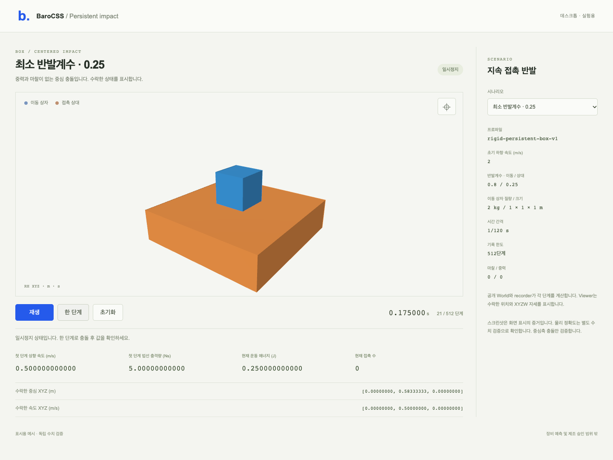

# Persistent box impact

The common World now applies the admitted minimum restitution to persistent
box-face impacts. Targets use each point's closing speed before this pair's
warm start, stay fixed for the step and are discarded before the next step.
The strict `>0.5m/s` switch, material mixing, solver iterations and public
four-body limit remain unchanged. There is no alternate engine or compatibility
argument. Live private inelastic studies pass an explicit zero target; their
archived inputs and results remain unchanged.

```sh
node examples/physics-persistent-impact-2276/scene/server.mjs
```

Open **http://127.0.0.1:52920** on desktop. Six presets compare minimum/zero/unit
restitution, the exact speed switch and its next represented value, and an
equal-mass pair. Step or play the actual public recorder; reset starts a new
World. The Viewer receives accepted poses with one SI-to-mm conversion.
Display boxes are proxies, not exact native CAD collision surfaces. The scene
starts paused and stops at512 recorded steps.



The independent exact-rational reference solves Newton's velocity relation
and conservation of momentum. It imports no candidate or manifold code.
Twenty finite impacts per graph include all three coordinate axes, ID/input
order, threshold neighbors, material limits, three dt values and separating/
resting controls. Source/compiled public API each pass28Worlds/287steps with
support, recording/restore/continuation, repeat and known/unknown refusals.
A separate warmed-cache campaign adds3Worlds/9steps per graph, including
restoration, a real cached support impulse, renewed impact, flight and a fault
after normal impulse application. These are separate campaigns, not one larger
run. All original1e-10 SI and1e-12 tangent gates remain.

Actual desktop Chrome passes11 checks at1280/1440/1920, covering six presets,
real GPU pixels, outgoing motion, accepted poses, camera and recording clock.
There are no mobile checks. Screenshots are rendering evidence only.

```sh
node examples/physics-persistent-impact-2276/build/build.mjs
node examples/physics-persistent-impact-2276/api-run.mjs fresh-api-id
python3 -B examples/physics-persistent-impact-2276/reference.py \
  examples/physics-persistent-impact-2276/evidence/fresh-api-id
node examples/physics-persistent-impact-2276/warm-run.mjs fresh-warm-id
PLAYWRIGHT_CLI=/absolute/path/to/installed/playwright-cli.js \
  node examples/physics-persistent-impact-2276/browser-run.mjs fresh-render-id \
  http://127.0.0.1:52920
```

Use the existing heavy gate/180s wrapper and fresh outputs. No tool installation
is automatic. The original outgoing-zero physical failure remains in the
evidence archive. Qualification is centered principal-axis, zero-friction
impact; it does not certify tilted/off-center/simultaneous impacts, general
friction or original eight-box settling. HOLDs, old failures and NO_GO stay.
See [results](RESULTS.md). No deployment, release or equipment prediction.
