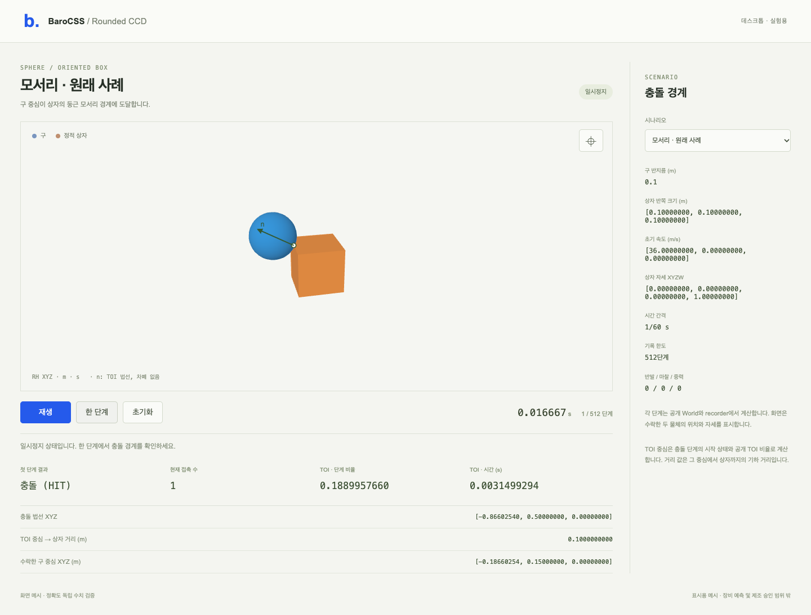

# Rounded sphere/box CCD

The Physics package now sweeps the Euclidean rounded box, replacing the old
expanded-rectangle false entry. This work includes independent geometry,
actual Source/compiled public World/recorder checks and a desktop Viewer scene.
It does not complete G2 contact-law coverage or the whole engine.

```sh
# Repository root, Node22 and existing workspace dependencies:
node examples/physics-rounded-ccd-2276/scene/server.mjs
```

Open **http://127.0.0.1:52900**. Select original corner, face, vertex, expanded
corner miss, or rotated-box control, or any of the16 original boundary controls. Step once to inspect true contact; play,
pause and reset drive the actual public recorder/World. The existing512-frame
recording cap remains. The contact marker/normal are overlays without depth
occlusion; sphere and box pixels come from the public WebGPU Viewer. Display
meshes are not the collision geometry or native CAD Surfaces.



## Kernel

`src/ccd-rounded-box.ts` uses exact dyadic integers for represented local input
coordinates, plane breaks, squared-distance polynomials, discriminant signs
and root-domain comparisons. At most7 intervals are examined. Stable-q roots
and projected normal numerators provide the final floating values. Nonfinite,
unrepresentable or invalid final results refuse NUMERIC_LIMIT. No fixture
whitelist, radius inflation, discriminant epsilon, time clamp or old-sweep
fallback is used. Builtin BigInt adds no dependency.

`ccd.ts` calls this kernel in each static box's frame. Existing profile input
ranges, fixture order/ties, initial true touch/overlap discrete ownership,
1e-9 inward bias, contact iterations and material laws remain. CCD still does
not integrate the remaining time after the hit. A static oriented fixture is
supported; general rotating-box CCD is not.

## Verification

The independent stdlib oracle enumerates6 face patches,12 finite edge cylinders
and8 vertex spheres. It does not use the candidate's interval builder.
Exact Fraction signs and directed80/120 roots/normals certify the original16
cases. Source results are checked immediately before the next case; all16
Source pass before16Native cases. Original C03 inputs and failures remain.

Actual Source and canonical compiled root/replay each pass26Worlds/29steps;
a separate unknown-error atomicity check adds1World/1step per graph. Tests cover
the16 cases, rectangular/rotation/translation/scale controls, earliest/tied
fixtures, actual recording restore/continuation and known/unknown failure
retention. Original compiled CCD, sphere-pair CCD, rotation and oriented
collider probes pass without changing their input or criteria.

Desktop Chrome tests use widths1280/1440/1920 and cover all16 original boundary
cases plus five feature scenes,
accepted poses, true hit/miss, contact distance and normal overlay, real pixels,
camera controls, pause/reset and the actual recorder clock. No mobile test runs.
The first renderer failure (duplicate surface IDs) and its original sources/
bundle/report remain separate. It was fixed by distinct ball/box display IDs.

All numerical gates remain: TOI1e-12, contact distance1e-12m, normal component
and squared-norm1e-12. Local exact predicates do not certify arbitrary world
coordinate scales or every quaternion rounding condition; final floats retain
numeric guards. The original conservative witness remains NO_GO historically.
No screenshot establishes physical accuracy. All prior HOLDs, stack NO_GO,
first failures and engine-level acceptance limits remain. No deploy/release.

## Reproduce

See CONTRACT.md and the frozen source/tool inputs. Existing heavy-lane and180s
command receipts are retained. Fresh output IDs are required.

```sh
node examples/physics-rounded-ccd-2276/build/build.mjs
node examples/physics-rounded-ccd-2276/geometry-run.mjs fresh-geometry-id
# api-run currently binds the saved geometry-01 bank; restore it from evidence.
node examples/physics-rounded-ccd-2276/api-run.mjs fresh-api-id
node examples/physics-rounded-ccd-2276/scene/server.mjs --build
PLAYWRIGHT_CLI=/absolute/path/to/installed/playwright-cli.js \
 node examples/physics-rounded-ccd-2276/browser-run.mjs fresh-browser-id http://127.0.0.1:52900
```

The server uses this checkout's public source APIs and an existing esbuild;
no tool installation or download is automatic. The CLI driver closes only its
isolated proof browser. Build/API/render success is distinct from the published
browser SDK, device-loss recovery, original8-box settling and hardware validation.
See [results](RESULTS.md); raw evidence and snapshots are archived with hashes.
