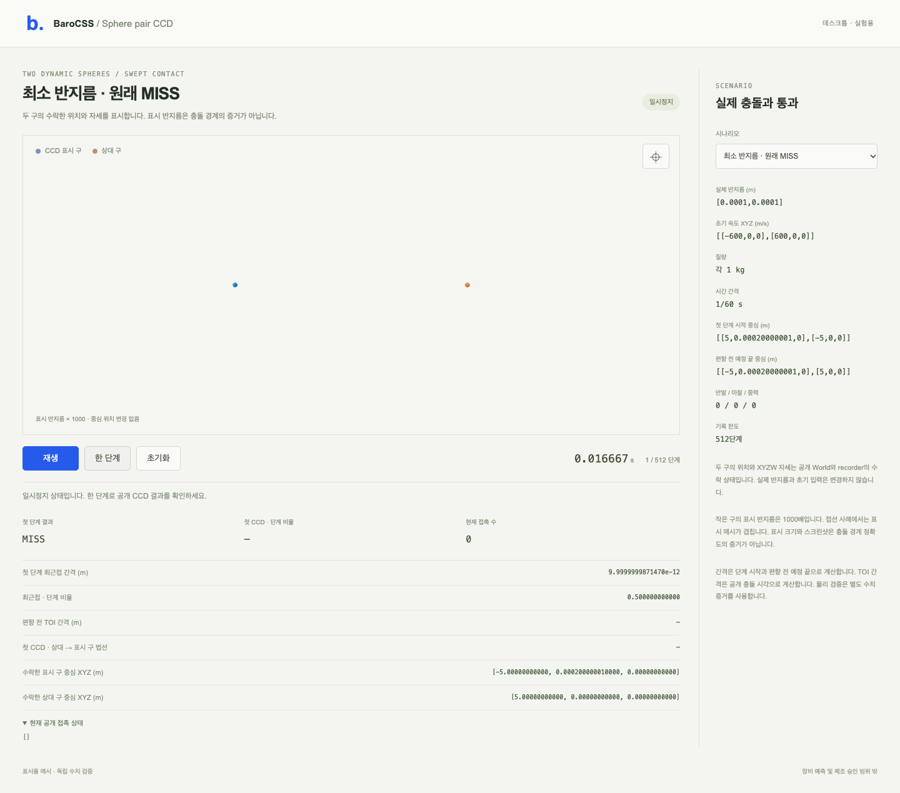

# Two-sphere CCD

The common World now classifies sphere-pair sweeps from exact represented
endpoints and separate radius operands. Initial ownership, zero relative motion,
separation, discriminant and segment endpoint decisions use dyadic integers.
Stable floating roots and closest-projection normals construct admitted hits.
There is one quadratic, fixed-size work, no epsilon/snap, search or fallback.
Both existing5e-10m inward biases and remaining-time discard stay unchanged.

The original minimum-radius witness is a real MISS with closest positive gap
9.999999987147026e-12m. The old compiled World reported a graze at0.5. Its
physical failure, inputs and provider remain preserved.

```sh
node examples/physics-sphere-pair-ccd-2276/scene/server.mjs
```

Open **http://127.0.0.1:52960** on desktop. The scene runs the public
World/recorder and Viewer, with original min-radius miss, real graze and ordinary
head-on/graze controls. Tiny spheres have an explicit display-radius multiplier
1000; accepted centers and XYZW are unchanged. Those proxies may occlude one
another. Display size is never a contact-distance proof. Ordinary controls use
physical display radii. Starts paused; actual recording stops at512 steps.



Independent Fraction closest-approach geometry classifies all22 frozen inputs
before the repaired candidate runs. Fixed80/120-digit chord geometry supplies
entry/normal references. Actual Source and canonical compiled root/replay each
pass29Worlds/33steps plus22direct private helper calls. A separate audit checks
all88helper/public results. Original public sphere-pair probe passes unchanged.
Actual desktop GPU rendering passes8checks/four inputs at1280/1440/1920.

```sh
node examples/physics-sphere-pair-ccd-2276/build/build.mjs
node examples/physics-sphere-pair-ccd-2276/api-run.mjs fresh-api-id
python3 -B examples/physics-sphere-pair-ccd-2276/reference.py \
  examples/physics-sphere-pair-ccd-2276/evidence/fresh-api-id \
  examples/physics-sphere-pair-ccd-2276/BANK-01.json
```

Use existing heavy gate/180s wrapper and installed tools; outputs must be fresh.
Unbiased TOI/distance/normal gates remain1e-12. Exact classification does not
guarantee binary64 output accuracy for every admitted extreme. No rotating
non-sphere CCD, remaining-time integration, friction-coupled impact, published
browser SDK, eight-box or equipment qualification. Original HOLDs/NO_GO and
first failures remain. No deployment or release. See [results](RESULTS.md).
