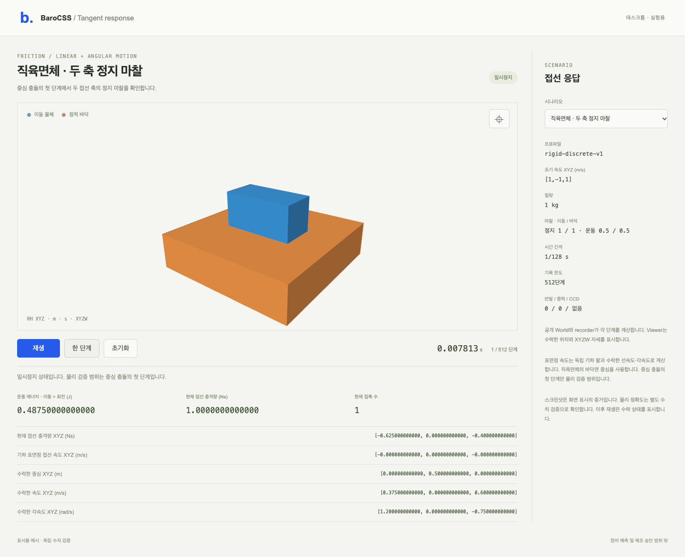

# Tangent response

The common World's discrete contact solver now solves both static tangent
constraints. For anisotropic cuboids, the required sticking impulse need not
point opposite the initial slip. A private pivoted2×2 solve uses finite/SPD
guards without epsilon or singular fallback. Uncoupled arithmetic and the
existing dynamic ray/clamp law remain. Iterations, admission and Coulomb
coefficients are unchanged.

Sphere/static-box tangent velocity, response and torque use the geometric
radius lever. A rounded projected center no longer moves an exact static
threshold into the dynamic branch. Tangent projection accounts for the actual
normal length with a vector cross-product identity; normal-only support gives
zero tangent even when the detector's unit normal has a rounding residual.

```sh
node examples/physics-tangent-response-2276/scene/server.mjs
```

Open **http://127.0.0.1:52940** on desktop. The default cuboid exposes both
tangent impulses, accepted velocity/spin, kinetic energy and geometric surface
slip. Three sphere presets retain the original failing binary64 boundary
inputs. The public recorder owns time; Viewer receives accepted SI poses with
one mm conversion. Starts paused,512-step recording cap. Cuboid physical proof
covers its first centered impact; later display playback is not another
physical qualification. Display meshes are proxies, not native CAD collision.



Twenty valid cuboid controls plus explicit invalid-input refusal pass through
each real Source/compiled API campaign:27Worlds/31accepted steps per graph.
Forty independent rational/80/120-digit audits solve principal-frame momentum
and no-slip equations, without the candidate basis or matrix code. Original
22sphere boundary cases pass unchanged on each final graph. Original support
3000steps and sliding/rolling240steps pass both source and compiled graphs.
The desktop Viewer passes9 real checks/four presets at1280/1440/1920.

Original sphere wrong-branch and cuboid residual-slip failures remain. The
first candidate's normal-only projection refusal and an invalid test coefficient
4 outside the existing[0,2] range also remain. The invalid input is explicitly
checked for refusal in `cases-02.mjs`; a separate valid coefficient2 control
was added. Original cases, gates and first-run files were not rewritten.

```sh
node examples/physics-tangent-response-2276/build/build.mjs
node examples/physics-tangent-response-2276/api-run.mjs fresh-id cases-02.mjs
python3 -B examples/physics-tangent-response-2276/reference.py \
  examples/physics-tangent-response-2276/evidence/fresh-id
node examples/physics-tangent-response-2276/regression.mjs fresh-regression-id
```

Use the existing heavy gate/180s wrapper, fresh outputs and installed tools.
Original sphere-table reruns require an explicit provider manifest; see
`../physics-material-boundaries-2276/README.md`. Source/native and rendering
are separate proof. General off-center normal/tangent coupling, persistent
friction, sphere-pair finite-overlap arm semantics, original eight-box settling
and real equipment remain unqualified/NO_GO. HOLDs stay; no deployment/release.
See [results](RESULTS.md).
