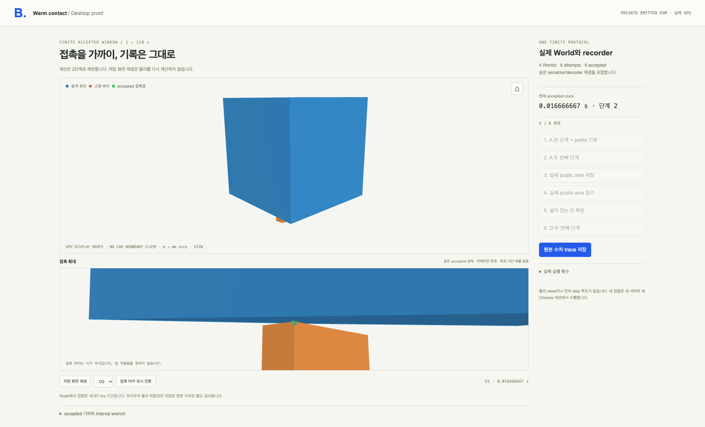

# Physics warm-contact desktop sample

Actual emitted World/recorder code drives the Viewer. The finite experiment uses
two accepted steps at dt=1/120 s (16.67 ms total), actual wire save/read, live
restore and continuation. Stored-frame playback changes only the display.

Desktop1280/1440/1920:10 checks PASS; page/console/network errors0. Independent
physical checks of the original browser words PASS separately. Observed browser/
Node bits agree for this campaign only. See [RESULTS](RESULTS.md).

```sh
node examples/physics-warm-viewer-2276/scene/server.mjs
```

Open the printed localhost URL in a fresh desktop session. Each server admits one
finite boot lease; restart that owned server for another experiment. No mobile
checks or deployment. Display geometry is a triangle proxy with exact primitive
extents, separate from independent native physics geometry. Original CAD surface
provenance, long-term stability, all contact laws and original8-box P4 stay outside
this result. Current package adoption remains pending.

The first capture failure and its unretained full trace, and the old lexical-
fragment resource refusal, are preserved. The qualified transport reads the SAME
retained second-run proof without a browser/World rerun. SOURCE and PROOF archives
are individually below16MiB; their aggregate exceeds16MiB. The archive index
records exact recovery paths and hashes.


