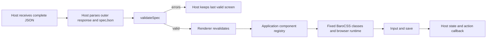

# `@barocss/render` private local library

This package builds a small React renderer for the existing profile-form contract. Implementation,
build and type declarations live in `packages/barocss-render`. It is **private**, ESM-only and
prototype-only: no npm publication, stable API promise, model transport or new component catalog.

## Build and use locally

React 19.2.3 is an external peer; the application also needs its normal React DOM/browser setup.
The build uses the repository's installed esbuild. It emits `dist/index.js` and `dist/index.d.ts`;
package root exports resolve those files, with no repository JSX or research-script import required.
Use installed assets; no dependency or browser download is part of these commands.

```sh
NODE=/Users/user/Library/pnpm/nodejs/22.19.0/bin/node
# Set REPO_DEPS_ROOT only when the current worktree lacks installed root tools.
REPO_DEPS_ROOT=/Users/user/.barocss-ai/v3/integration \
  "$NODE" packages/barocss-render/build.mjs
```

Link the built package into a local consumer's `node_modules/@barocss/render`, or use a local package
copy containing its `package.json` and `dist`. That consumer supplies React. Source is not a package
export. The [small TypeScript example](./examples/profile-form.tsx) imports only React and
`@barocss/render`; it defines application components, state and a save callback, not another server
or model caller. Its fixture is authored form-compatible data, **not a captured model response**.

```tsx
import { Renderer, validateSpec, classesFor } from '@barocss/render';
import type { ComponentRegistry, FormState, ScreenSpec } from '@barocss/render';
```

The existing [loopback demo](../../scripts/barocss-render-loop/README.md) remains the interactive
Generate → name input → Save → confirmation host. Its default authored-mock mode calls no model.
It still uses its retained source-based research adapter; the new separate-consumer check below
uses the **built package**. These are distinct evidence paths, not a second demo framework.

## Data flow and ownership



The renderer receives an **inner screen object**. It does not parse a JSON string or unwrap the
research host's `{ "specJson": "..." }` envelope. The host does both JSON.parse steps and calls
`validateSpec` before accepting a candidate. No repair or normalization occurs. `validateSpec`
returns `{ ok: boolean, errors: { path, message }[] }`, not a normalized spec or TypeScript type guard.
After `ok`, a typed host can treat the checked candidate as `ScreenSpec`.

The host owns:

- The last valid screen and parse/validation error display. `Renderer` throws on an invalid spec;
  it is not an error boundary and does not store an earlier screen.
- Form state, its setter and the `save` function. The default `FormState` is `{ name: string }`;
  generic state is also passed through to application components. The renderer does not validate
  state values or action registry functions. A used action must have a callable host handler.
- All component functions and their HTML. The typed `ComponentRegistry` names the five existing
  components. Register ordinary React component functions/classes; wrapped object-valued memo or
  forwardRef registrations are not supported by the current function check. A missing used component
  throws `Missing registered component: TYPE`.
- BaroCSS browser startup. `classesFor` maps validated Layout/Card style choices to reviewed classes;
  other nodes return an empty string. Application components may add fixed authored utility classes.
  The package starts no CSS runtime and accepts no arbitrary class, HTML, JS or CSS string from JSON.
- Any model connection, session, timeout, revision, cancellation or next-response action. These are
  application concerns. The package calls no model, opens no network connection and keeps no CLI session.

Each node ID is its React key. Stable ID and component position can preserve an input during a
complete-screen update. Moving or replacing that node can remount it; the host remains responsible
for state and focus. Text is rendered through the application's ordinary React text children.

## Existing screen contract

`validateSpec(unknown)` accepts only `root` and `elements`, with 2–32 nodes. Root must be a Layout.
Node IDs match `[a-z][a-z0-9-]{0,31}`, and each `props.id` matches its element key. All references must
exist, each node has one parent, all nodes are reachable and cycles are rejected. Unknown fields,
props and component types fail. Text/labels require 1–300 characters.

| Component | Required props in addition to id | Children / action |
| --- | --- | --- |
| Layout | columns: responsive or single; gap: fractional or wide | Node ID array |
| Card | padding: fractional or spacious; tone: light or dark | Node ID array |
| Text | text | Empty array |
| Input | label; value: `{ "$bindState": "/name" }` | Empty array |
| Button | label | Empty array; on: `{ "press": { "action": "save" } }` |

Type declarations express the component/prop/style/binding/action shapes. They cannot prove node
counts, ID equality, graph structure, text length or that untrusted runtime data is valid. Always
run the runtime validator. `classesFor` expects an already validated node and is not another validator.

## Verify a separate built-package consumer

Use the already installed esbuild, TypeScript, React/React DOM, React type declarations and Chromium.
The default package `test` runs the built ESM export smoke check with the installed React peer.
The focused `test:consumer` includes TypeScript and browser interaction checks and needs the installed
asset paths below. React type declarations belong to the consuming TypeScript application's setup.
No `pnpm install`, browser download, native Codex process or paid model call is needed.

```sh
NODE=/Users/user/Library/pnpm/nodejs/22.19.0/bin/node
export REPO_DEPS_ROOT=/Users/user/.barocss-ai/v3/integration
export REACT_ROOT=/Users/user/.barocss-ai/v3/wt/issue-446/scripts/json-render-446/scratch/jr
export REACT_TYPES_ROOT=/Users/user/github/ai-based/abs
export PW_DIR=/Users/user/github/ai-based/abs/node_modules/.pnpm/playwright-core@1.60.0/node_modules/playwright-core
"$NODE" --test packages/barocss-render/tests/consumer.test.mjs
```

The check builds the package, copies only package metadata and dist into a separate temporary consumer,
and links installed React peers. No renderer source directory or research scripts are copied. It then:

1. Type-checks the example against built declarations and rejects unsupported component/style/binding/action types.
2. Bundles a browser consumer through package root exports; all inputs are the isolated consumer or installed third-party assets.
3. Measures applied BaroCSS layout classes, changes the input and invokes the host save callback.
4. Rejects invalid data, retains the previous valid screen and input, then accepts another complete screen.
5. Checks no page errors or external requests and records an authored screenshot. These observations
   establish this narrow local consumer path, not arbitrary UI support or model performance.

Set `CONSUMER_RESULT_ROOT` to an existing private output root to retain the report, screenshot and
bundler inputs. Each run creates a fresh child directory. The report binds artifact hashes to the
source commit and records whether the worktree was clean. Keep real captured inputs private.

## Retained research and limits

The [#469 result](../../scripts/barocss-render-progressive/RESULT-469.md) and
[data-lineage manifest](../../scripts/barocss-render-progressive/DATA-LINEAGE-469.json) distinguish
original stream bytes, parsed agent text, screen specs, state/action projections and browser evidence.
That measurement stage ended before any new model turn. The historical #458 corpus has 18 verified
actual complete responses, including the accepted #460 two-turn pair; the new consumer test uses
separate deterministic authored data. It adds no model observation or launch allowance.

Historical freezes bind exact source and README bytes. This updated README intentionally makes the
#458 freeze differ at current HEAD. Old plans, claims, corpus and accepted baseline commits remain
unchanged. Historical verification runs at their retained baseline; new built-package/consumer
verification binds to this candidate. Do not rewrite old freezes or use a historical live ACCEPT
for this new package build. See [local-library result](./RESULT-470.md) for exact evidence and checks.
