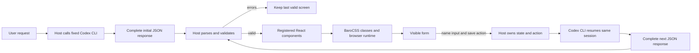

# `@barocss/render` private prototype

This workspace package tests a small React renderer for a fixed profile form. It is private and exports source JSX. It has no publish build, Changeset, release, or stable API promise.

## How a screen reaches the browser



The [#460 accepted live proof](https://github.com/barocss/barocss/issues/460#issuecomment-5862705075) followed this path for one profile form and one action-driven confirmation. It used two complete responses in one CLI session. This is a private prototype observation, not a streaming or latency claim. The package contains the validator and renderer; the [loopback host](../../scripts/barocss-render-loop/README.md) owns CLI calls and actions. The authored fixture and API example below remain separate from model output.

1. The host parses JSON. `validateSpec` returns `{ ok, errors }`; each error has a field path and message. The host keeps the last valid spec if parsing or validation fails.
2. Validation accepts only `root`, `elements`, 2–32 nodes, and the registered `Layout`, `Card`, `Text`, `Input`, and `Button` shapes. It checks required props, exact style choices, the `/name` binding, the `save` action, ID references, one parent per node, reachability, and cycles. Unknown fields and components fail.
3. The host passes a valid spec, a component registry, form state, a state setter, and a named action registry to `Renderer`. `Renderer` validates again before it constructs React elements. A missing registered component also fails.
4. Each JSON node ID becomes a React key. The registered components create HTML elements. `classesFor` maps reviewed style names to fixed BaroCSS utility classes; the JSON cannot supply a class string. The host starts the BaroCSS browser runtime and preloads the fixed class set before rendering.
5. `Input` reads `state.name` and calls the host setter. `Button` calls the registered `save` function. The renderer does not execute JSON, create arbitrary HTML, or perform a network request.
6. When the host accepts a new complete JSON screen, React updates the tree. An unrelated new node can leave the existing input value and focus in place because its ID and component position stay stable. Moving or replacing that node can remount it and lose focus. The host owns the form state and the last valid spec.

## Actual accepted JSON

This is the authored [comparison fixture](../../scripts/barocss-render-prototype/fixture.mjs). It is not model output.

```json
{
  "root": "layout",
  "elements": {
    "layout": { "type": "Layout", "props": { "id": "layout", "columns": "responsive", "gap": "fractional" }, "children": ["card"] },
    "card": { "type": "Card", "props": { "id": "card", "padding": "fractional", "tone": "light" }, "children": ["heading", "name", "save"] },
    "heading": { "type": "Text", "props": { "id": "heading", "text": "Profile settings" }, "children": [] },
    "name": { "type": "Input", "props": { "id": "name", "label": "Name", "value": { "$bindState": "/name" } }, "children": [] },
    "save": { "type": "Button", "props": { "id": "save", "label": "Save profile" }, "children": [], "on": { "press": { "action": "save" } } }
  }
}
```

## API example

This authored example uses the comparison app's real component registry. If an editor calls `applyJson`, invalid edits set errors and leave `acceptedSpec` unchanged. The host must load and start BaroCSS before it mounts this component, as [the loopback demo does](../../scripts/barocss-render-prototype/serve.mjs). The relative imports below assume this code sits in this package directory.

```jsx
import { useState } from 'react';
import { Renderer, validateSpec } from '@barocss/render';
import { Layout, Card, Text, Input, Button } from '../../scripts/barocss-render-prototype/visual.jsx';
import { INITIAL } from '../../scripts/barocss-render-prototype/fixture.mjs';

const components = {
  Layout, Card, Text,
  Input: ({ node, state, setState }) => <Input node={node} value={state.name}
    onChange={(name) => setState((old) => ({ ...old, name }))} />,
  Button: ({ node, onAction }) => <Button node={node} onClick={onAction} />,
};

function ScreenHost({ onSave }) {
  const [acceptedSpec, setAcceptedSpec] = useState(INITIAL);
  const [state, setState] = useState({ name: 'Ada' });
  const [errors, setErrors] = useState([]);

  function applyJson(raw) {
    let candidate;
    try { candidate = JSON.parse(raw); }
    catch { setErrors([{ path: '$', message: 'Invalid JSON' }]); return; }
    const result = validateSpec(candidate);
    setErrors(result.errors);
    if (result.ok) setAcceptedSpec(candidate);
  }

  const actions = { save: () => onSave({ name: state.name }) };
  return <>
    <textarea aria-label="Screen JSON" onChange={(event) => applyJson(event.target.value)} />
    <ul>{errors.map(({ path, message }) => <li key={path}>{path}: {message}</li>)}</ul>
    <Renderer spec={acceptedSpec} components={components} state={state}
      setState={setState} actions={actions} />
  </>;
}
```

The demo uses an in-memory action log. See [the prototype adapter](../../scripts/barocss-render-prototype/prototype-adapter.jsx) and [browser host](../../scripts/barocss-render-prototype/browser-app.jsx) for the executed path.

## Current boundary

This package accepts a screen-specific data contract. It does not call Codex or Claude, retain an agent session, or accept generated scripts or arbitrary CSS. The separate [#460 loopback host](../../scripts/barocss-render-loop/README.md) ran one accepted two-turn CLI proof under a separate review and launch gate. The [authored comparison and decision](../../scripts/barocss-render-prototype/README.md) measure this private prototype against official json-render with the same authored fixture.
